## Índice

0. [Ficha del proyecto](#0-ficha-del-proyecto)
1. [Descripción general del producto](#1-descripción-general-del-producto)
2. [Arquitectura del sistema](#2-arquitectura-del-sistema)
3. [Modelo de datos](#3-modelo-de-datos)
4. [Especificación de la API](#4-especificación-de-la-api)
5. [Historias de usuario, tickets de trabajo y pull requests](#5-historias-de-usuario-tickets-de-trabajo-y-pull-requests)

---

<br>

## 0. Ficha del proyecto

### **0.1. Tu nombre completo:**

Enrique Reaño Fazio

### **0.2. Nombre del proyecto:**

CalendarSchool

### **0.3. Descripción breve del proyecto:**

**CalendarSchool** es un sistema integral de gestión de horarios escolares que automatiza la creación, validación y asignación de calendarios académicos, restricciones de carga horaria, y generación de horarios optimizados para centros educativos. Resuelve la compleja tarea de generar horarios respetando múltiples restricciones (disponibilidad de profesores, ubicación física única, carga horaria equilibrada) mediante algoritmos de optimización (CSP/Backtracking) y proporciona herramientas de auditoría y cumplimiento normativo (GDPR).

**Stack tecnológico:**
- **Backend:** Node.js 24 LTS + TypeScript + Express.js
- **Frontend:** React 19 + TypeScript + Bootstrap 5.3 (Vite)
- **Base de Datos:** PostgreSQL 17 (Supabase en producción) + Prisma ORM
- **Testing:** Vitest + Supertest + Cypress (E2E)
- **Deployment:** AWS (CloudFront + S3 + API Gateway + Lambda) con CDK en TypeScript y GitHub Actions

**Usuarios objetivo:** personal de gestión de centros de Infantil y Primaria de la Comunitat Valenciana (jefatura de estudios, dirección y administración), con roles de administrador o miembro en la aplicación  
**Alcance MVP:** 240+ casos de uso, repartidos en las historias de usuario de `docs/User_Stories_MVP.md`


### **0.4. URL del proyecto:**

`https://app.calendarschools.es` (se publica con la puesta en marcha de `docs/despliegue/PUESTA_EN_MARCHA.md`; el registro y el inicio de sesión están abiertos desde el cambio `inicio-sesion`, US02)

### 0.5. URL o archivo comprimido del repositorio

https://github.com/kiketon007/CalendarSchool

---

<br>

## 1. Descripción general del producto

### **1.1. Objetivo:**

**Automatizar la generación de horarios escolares** eliminando el proceso manual que consume 20-40 horas semanales de trabajo administrativo en centros educativos. CalendarSchool proporciona:

- **Generación optimizada de horarios:** Algoritmos CSP (Constraint Satisfaction Problem) y Backtracking que respetan todas las restricciones académicas
- **Validación de restricciones críticas:** Garantiza que profesores no estén en 2 aulas simultáneamente (SINGLE_LOCATION), carga horaria equilibrada, disponibilidad de profesores
- **Auditoría y cumplimiento normativo:** Trazabilidad completa de cambios, soft delete GDPR-compliant, control de sesiones con revocación de tokens JWT
- **Gestión centralizada:** Dashboard único para configurar calendarios, asignaturas, restricciones y revisar horarios generados

**Para quién:** Jefes de Estudios, Directores, Coordinadores de Horarios que necesitan generar horarios fiables en horas (vs días o semanas manualmente)

**Valor aportado:**
- Ahorro de 20-40 horas/semana en trabajo manual
- Reducción de errores de planificación (0 conflictos HC-validados)
- Flexibilidad: cambios rápidos en restricciones → regeneración automática
- Cumplimiento normativo: auditoría completa, GDPR, control de acceso

### **1.2. Características y funcionalidades principales:**

> **Estado:** hoy están implementados y desplegados el Módulo 1 (autenticación y usuarios del colegio) y el Módulo 1b (cursos, profesores y alumnos). Los módulos 2 a 9 y la parte de «Seguridad & Auditoría» que no aparece en la §2.5 describen la funcionalidad **prevista** 🎯: aunque lleven ✅, todavía no están construidos.

#### **Módulo 1: Autenticación y Control de Acceso (US01-US04, US02_b y US02_c)**
- ✅ Autenticación JWT con refresh tokens persistentes
- ✅ Revocación de tokens por logout, cambio de contraseña, o logout forzado por admin
- ✅ Varios usuarios por colegio con roles `ADMIN` y `MEMBER`, incorporados con un enlace de invitación (sin envío de correo)
- ✅ Sesiones con fecha de caducidad y revocación; la IP y el user agent no se guardan en la base de datos, solo quedan en los logs (30 días)
- ✅ Restablecimiento de contraseña con un enlace de un solo uso (sin envío de correo)
- ✅ Pantalla de bienvenida con las funcionalidades y el atajo a «Usuarios» para el administrador

#### **Módulo 1b: Datos del colegio (US05-US18)**
- ✅ Cursos con sus clases: crear, listar, editar (las clases conservan su identidad al renombrarse) y borrar mostrando antes lo que se pierde
- ✅ Profesores con la clase que tutorizan: crear, listar con búsqueda y paginación, editar y borrar
- ✅ Alumnos con curso, clase, comedor, beca, tipo de comida y observaciones: crear, listar con búsqueda, filtros y paginación en la URL, editar y borrar con confirmación volviendo al listado con sus filtros
- ✅ `foodType` y `observations` son datos sensibles: no salen en el listado ni en los logs

#### **Módulo 2: Gestión de Calendarios Base (US-BASE)**
- ✅ Varios calendarios por colegio (por ejemplo, Infantil y Primaria): nombre único por colegio y la misma jornada de lunes a viernes, sin fechas (US-BASE)
- ✅ Auto-generación de sesiones (1-8 por día) y edición a mano de cada hora (las filas se ordenan por hora al guardar); resumen «N sesiones al día · 5×N a la semana · M minutos lectivos al día»
- ✅ Soporte para recreos (hasta 2, entre dos sesiones)
- ✅ Validación: sin solapamientos y como máximo 90 min por periodo
- ✅ Cada curso sigue como máximo un calendario, que se asigna desde el formulario (crear uno con un curso que ya seguía otro lo mueve)
- ✅ Los administradores crean y todos los usuarios ven los calendarios
- ✅ Editar un calendario (US-BASE_b): nombre, jornada y cursos, con «Guardar» solo con cambios; los cursos que se desmarcan quedan sin calendario y gana el último guardado
- ✅ Borrar un calendario (US-BASE_c), con aviso de los cursos que se quedan sin calendario; los cursos no se borran

#### **Módulo 3: Gestión de Asignaturas (US-SUBJECT, US-SUBJECT_b y US-SUBJECT_c)**
- ✅ Crear y ver las asignaturas del colegio (US-SUBJECT): nombre único por colegio, código opcional (de 1 a 10 caracteres, único por colegio si se rellena), tipo (CORE, ELECTIVE, CUSTOM), estado (ACTIVE, INACTIVE), descripción y un color de una paleta cerrada de 12 colores
- ✅ Cursos del colegio en los que se imparte, cada uno con sus sesiones semanales (de 1 a 5; 2 al marcarlo); un curso borrado se quita de la asignatura, que sigue existiendo
- ✅ Listado con filtros por tipo y estado y búsqueda por nombre o código en el navegador, y el resumen de cursos y sesiones desplegable
- ✅ Editar una asignatura (US-SUBJECT_b): nombre, código, tipo, estado, descripción, color y cursos con sus sesiones; inactivarla es cambiar el estado desde el formulario. Gana el último guardado, «Guardar» solo se habilita con cambios reales, un curso que se desmarca y se vuelve a marcar recupera sus sesiones y una asignatura sin cursos exige marcar alguno
- ✅ Borrar una asignatura (US-SUBJECT_c): borrado de verdad con una sola confirmación que lista los cursos en los que se imparte y recuerda, como texto, que si solo ha dejado de impartirse puede inactivarla desde «Editar». Las filas de sus cursos caen con ella y los cursos no se tocan; el nombre y el código quedan libres
- ✅ Los administradores crean, editan y borran y todos los usuarios ven las asignaturas
- 🎯 El prerrelleno de las restricciones, el aviso de uso y el borrado en cascada de las restricciones llegan con US19

#### **Módulo 4: Carga horaria y reglas de reparto (US19 y US19_b a US19_d)**
- ✅ Carga horaria por curso (US19): una matriz con todas las asignaturas del colegio y un selector de sesiones por semana («No se imparte», de 1 a 5) sobre `subject_courses`, que sigue siendo la única fuente de la carga
- ✅ Balance «N de M sesiones a la semana» frente a las sesiones del calendario del curso (sesiones al día × 5, no 25 fijas), con una barra decorativa y avisos con palabras: la carga supera el calendario o el curso no tiene calendario. Los avisos nunca impiden guardar
- ✅ Solo los administradores ajustan la carga y todos los usuarios la ven; se guarda únicamente lo que cambia (`PATCH`), así que dos personas que cambian asignaturas distintas del mismo curso no se pisan
- ✅ Reglas de reparto de una asignatura en un curso (US19_b): un máximo de sesiones al día (2 a 5; sin regla, una) y bloques de 2 o 3 sesiones seguidas, desde la misma matriz, con avisos por asignatura (el bloque es mayor que la carga; no cabe en la semana porque ningún tramo sin recreo llega al bloque) que nunca impiden guardar. Se guardan en `scheduling_constraints`, cuelgan de la pareja asignatura-curso y se borran con ella; las páginas de asignaturas y de cursos avisan de las reglas que se perderían
- 🎯 Franjas prohibidas y franjas preferidas (US19_c y US19_d), con avisos «no cabe». Solo las gestionan los administradores
- 🎯 La disponibilidad del profesor es de US-PROF-AVAIL y la regla de ubicación única del profesor es fija del motor de generación (US-ALGO-RUN), no una restricción que se configure

#### **Módulo 5: Listado de reglas de reparto (US20)**
- 🎯 Listado de solo lectura de las reglas del colegio (asignatura, curso, tipo y detalle) con filtros por tipo y curso, búsqueda por asignatura y «Solo con avisos»
- 🎯 Enlaces «Editar» (administradores) o «Ver» (miembros) a la carga del curso o a la cuadrícula de franjas de cada regla

#### **Módulo 6: Disponibilidad de Profesores (US-PROF-AVAIL)**
- ✅ Grid visual: Lun-Vie × Sesiones (marcar disponible/no disponible)
- ✅ Botones conveniencia: Marcar Todo, Solo Mañana, Solo Tarde, Inversión
- ✅ Display: franjas disponibles + barra visual %
- ✅ Validación: no más de X sesiones simultáneas

#### **Módulo 7: Asignación de Asignaturas (US-PROF-ASSIGN)**
- ✅ Profesor + Asignatura + Cursos + Sesiones/Semana
- ✅ Cálculo dinámico: cursos × sesiones = total sesiones
- ✅ Validaciones: no duplicados, no mismatch restricción, disponibilidad suficiente
- ✅ Avisos permitidos (sobrecarga) → horarios marked NEEDS_REVIEW

#### **Módulo 8: Resumen de Carga (US-PROF-SUMMARY)**
- ✅ Tabla maestro: Profesor | Asignaturas | Total Sesiones | Disponibilidad | Estado
- ✅ Indicador color: 🟢 OK (0-75%), 🟡 Aviso (75-100%), 🔴 Error (>100%)
- ✅ Expandible: detalles, timeline, advertencias
- ✅ Acciones rápidas: editar disponibilidad/asignaciones
- ✅ Exportar CSV

#### **Módulo 9: Generación de Horarios (US-ALGO - Futuro)**
- ✅ Algoritmo CSP/Backtracking configurable
- ✅ Job queue con progreso en tiempo real
- ✅ 7 vistas de detección automática de conflictos:
  - professor_overlap (profesor en 2 aulas)
  - no_room (asignación sin aula)
  - availability (fuera de disponibilidad)
  - professor_load (carga horaria)
  - professor_availability_summary (% disponible)
  - restriction_audit_trail (auditoría restricciones)
- ✅ Descarga horarios (PDF, Excel)

#### **Seguridad & Auditoría**
- ✅ Control JWT con refresh tokens revocables
- ✅ Auditoría completa: createdBy/updatedBy en 7 tablas
- ✅ Soft delete GDPR: deletedAt en profesores, materias, calendarios
- ✅ Validaciones Hard Constraints (HC1-HC6) en schema
- ✅ Triggers automáticos: marcar conflictos en cambios
- ✅ Índices optimizados: búsqueda case-insensitive, performance O(log n)

### **1.3. Diseño y experiencia de usuario:**

No hay maquetas ni un sistema de diseño aparte: la interfaz se construye con Bootstrap 5.3 (`react-bootstrap`), sin personalización de estilos, y estas son las reglas que siguen todas las pantallas:

- **Responsive:** los listados (cursos, profesores y alumnos) son una tabla desde 768 px y tarjetas por debajo; cada pantalla se comprueba también a 360 px, sin desplazamiento horizontal.
- **Idioma:** castellano por defecto y textos también en inglés, siempre a través de i18n (`es.json` y `en.json`).
- **Accesibilidad (WCAG 2.1 AA):** campos con etiqueta y errores asociados, el foco en el primer error o en el título tras una acción, avisos anunciados con `role="status"` o `alert`, diálogos con el foco inicial en «Cancelar» y controles desactivados explicados. Los formularios de registro y de inicio de sesión se comprueban además con axe-core.
- **Formularios:** validación en línea con las mismas reglas que el backend, un solo envío aunque se pulse dos veces, «Guardar» solo cuando hay cambios al editar y el borrador del registro conservado en la pestaña.
- **Listados:** carga única con reintento, estado vacío con la acción para crear, búsqueda y filtros en el navegador, paginación de 20 en 20 y, en los alumnos, los filtros y la página en la URL para poder volver a ellos tras editar.
- **Datos sensibles:** el tipo de comida y las observaciones de un alumno solo se ven en su formulario, nunca en el listado ni en los diálogos.

### **1.4. Instrucciones de instalación:**

**Requisitos:** Node.js 24 LTS (versión fijada en `.nvmrc`), npm 11 y Docker con Docker Compose. En Windows, clona primero el repositorio con soporte de enlaces simbólicos (ver *Clonado del repositorio* más abajo).

**Instalación y arranque local:**

1. Instala las dependencias. También genera el cliente Prisma, aunque todavía no exista `backend/.env`:

   ```bash
   npm install
   ```

2. Crea el fichero de entorno del backend a partir de la plantilla. Sus credenciales son solo de desarrollo local y coinciden con `docker-compose.yml`:

   ```bash
   cp backend/.env.example backend/.env              # bash
   Copy-Item backend/.env.example backend/.env       # PowerShell
   ```

   Además de la base de datos, la plantilla define dos variables que el backend exige al arrancar (US01_c): `JWT_SECRET` (secreto de firma de los access tokens, de 32 caracteres como mínimo) y `APP_ORIGIN` (origen del frontend, `http://localhost:5173` en desarrollo, desde el que se acepta `POST /api/auth/refresh`). Sus valores son solo de desarrollo; en producción llegan cifrados desde AWS y nunca se versionan.

   Tres variables más son opcionales y la plantilla las muestra comentadas con su valor por defecto (US01_d y US02): `TRUST_PROXY_HOPS` (número de proxies de confianza delante del backend; `0` en local, donde la IP del cliente es la de la conexión), `REGISTRATION_ATTEMPTS_MAX` (máximo de intentos de registro por IP cada 15 minutos, 5 por defecto) y `LOGIN_ATTEMPTS_MAX` (máximo de intentos de inicio de sesión **fallidos** por IP cada 15 minutos, 10 por defecto; los correctos no cuentan). En local todas las peticiones llegan desde la misma IP: si pruebas el registro más de 5 veces seguidas, o fallas el inicio de sesión más de 10, recibirás un `429` durante 15 minutos, así que sube `REGISTRATION_ATTEMPTS_MAX` o `LOGIN_ATTEMPTS_MAX` en `backend/.env`. El E2E ya los arranca con 1000.

   Los secretos de reCAPTCHA (US01_e), `RECAPTCHA_V3_SECRET` (clave por score) y `RECAPTCHA_V2_SECRET` (clave de reto), también van comentados en la plantilla: se definen las dos o ninguna. **Sin ellas el backend usa un verificador de captcha falso**, que acepta casi cualquier token y avisa en el log al arrancar; es lo que usan el desarrollo, los tests y el E2E, así que no necesitas claves de Google para trabajar. **En producción son obligatorias**: con `NODE_ENV=production` el backend no arranca sin ellas. Las claves se crean en un proyecto de Google Cloud (Google ya no crea claves de reCAPTCHA «clásico») y nunca se versionan.

   El frontend tiene su propia plantilla, `frontend/.env.example`, que se copia a `frontend/.env.local`: `VITE_RECAPTCHA_SITE_KEY_V3` y `VITE_RECAPTCHA_SITE_KEY_V2` (claves de sitio, públicas; las dos o ninguna). Sin ellas el frontend usa un cliente de captcha falso que no carga nada de Google y pinta un reto simulado. Para provocar cada caso con el verificador falso, cambia el token del registro por uno de los reservados: `fake-low-score` (con `v3`: pide el reto v2), `fake-fail` (verificación fallida) o `fake-unavailable` (Google no disponible); cualquier otro se acepta.

   La cookie de sesión (`refresh_token`) lleva el atributo `Secure`. Chrome, Firefox y Edge la aceptan sobre `http://localhost`; **Safari no**, por lo que en Safari la sesión no se mantiene en desarrollo local y el registro avisa de que se necesitan cookies.

3. Levanta PostgreSQL 17 (la misma versión mayor que la base de producción), que crea las bases `calendarschool` (desarrollo) y `calendarschool_test` (tests):

   ```bash
   docker compose up -d
   ```

4. Aplica las migraciones a la base de desarrollo. Nunca se aplican de forma implícita: repite este paso tras traer migraciones nuevas.

   ```bash
   npm run db:migrate
   ```

5. Arranca backend y frontend en paralelo. El frontend está en `http://localhost:5173` y redirige `/api/*` al backend (`http://localhost:3000`):

   ```bash
   npm run dev
   ```

   Comprobación: `http://localhost:5173/api/health` responde `{"success":true,"data":{"status":"ok","database":"up"}}`.

**Tests y calidad:**

| Comando | Qué hace |
|---|---|
| `npm test` | Tests unitarios y de integración del backend y tests del frontend, con cobertura (90 % backend, 80 % frontend). Requiere PostgreSQL levantado. |
| `npm run test:unit` | Tests sin base de datos (backend unitario y frontend). |
| `npm run test:e2e` | Compila, migra el esquema `public` de la base de test, arranca el backend en `:3001` y `vite preview` en `:4173` y ejecuta Cypress en modo headless. Es el mismo script que usa CI. Los argumentos tras `--` se pasan a Cypress: `npm run test:e2e -- --spec cypress/e2e/session.cy.ts` ejecuta una sola spec. |
| `npm run lint` / `npm run format` | ESLint y Prettier sobre `backend` y `frontend`. |
| `npm run build` | Build de ambos workspaces. |

Al hacer commit, un hook (husky + lint-staged) corrige y formatea los ficheros modificados de `backend/`, `frontend/` e `infrastructure/`, y bloquea el commit si quedan errores de lint.

**Problemas frecuentes:**

- **Vienes de una versión con PostgreSQL 18, o el contenedor no arranca.** El volumen de datos de la 18 no sirve con la 17. Recréalo (se pierden los datos locales): `docker compose down -v` y `docker compose up -d`, y vuelve a aplicar las migraciones con `npm run db:migrate`.
- **No existe `calendarschool_test`.** El script que la crea solo se ejecuta al crear el volumen de Docker por primera vez. Si el volumen ya existía, recréalo (se pierden los datos locales): `docker compose down -v` y `docker compose up -d`.
- **El puerto 5432 está ocupado.** Otro PostgreSQL (por ejemplo, el contenedor de otro proyecto) lo está usando: páralo antes de `docker compose up -d`. Si el contenedor de este proyecto arrancó sin el puerto publicado (`docker ps` no muestra `0.0.0.0:5432->5432/tcp`), recréalo con `docker compose up -d --force-recreate`.
- **`npm run test:e2e` falla con «El puerto 3001 (o 4173) está ocupado».** Cierra el proceso que lo usa. El E2E puede ejecutarse con `npm run dev` en marcha, porque usa otros puertos.
- **Cypress se cae («Renderer process crashed» o «heap out of memory»).** Falta memoria libre en la máquina: cierra aplicaciones y repite. El E2E tiene un tiempo máximo de 10 minutos (`E2E_CYPRESS_TIMEOUT_MS`) para no quedarse colgado.
- **Aparece `lint-staged automatic backup` en `git stash list`.** En Windows, cuando el hook bloquea un commit, lint-staged puede no borrar su copia de seguridad. No se pierde nada: comprueba con `git diff stash@{0}` que coincide con tu árbol de trabajo y elimínala con `git stash drop`.

**Clonado del repositorio (enlaces simbólicos):** los agentes y skills de IA viven en `ai-specs/` y se exponen en `.claude/` y `.cursor/` mediante enlaces simbólicos. En Windows, Git los convierte en ficheros de texto si no se habilitan, y las skills y agentes dejan de funcionar. Antes de clonar:

1. Activa el **Modo de desarrollador** de Windows (Configuración → Sistema → Para programadores) o ejecuta la terminal como administrador.
2. Clona con soporte de enlaces simbólicos:

   ```bash
   git clone -c core.symlinks=true https://github.com/kiketon007/CalendarSchool.git
   ```

En un clon ya existente: `git config core.symlinks true`, borra `.claude/agents`, `.claude/skills`, `.cursor/agents` y `.cursor/skills`, y restáuralos con `git checkout -- .claude .cursor`. En macOS y Linux no se necesita ningún paso adicional.

---

## 2. Arquitectura del Sistema

### **2.1. Diagrama de arquitectura:**
**Patrón**: Aplicación de tipo monolito modular (separación de backend y frontend a nivel de estructura de carpetas) con arquitectura en capas (Layered Architecture).

CalendarSchool sigue una **arquitectura de 4 capas** (Presentación → Aplicación → Datos → Infraestructura) que permite separación clara de responsabilidades, escalabilidad independiente y fácil testing. Se ha elegido esta arquitectura porque:
1. **Separación de responsabilidades**: Frontend (React), Backend (Express), BD (PostgreSQL + ORM Prisma) evolucionan independientemente.
La separación en 4 capas aplica el principio de responsabilidad única. La capa de Aplicación coordina los casos de uso sin conocer la interfaz de usuario ni los detalles de persistencia. La capa de Datos/Dominio define la estructura y reglas de negocio principales, mientras que la Infraestructura gestiona la integración externa y el acceso a datos.
2. **DX (Developer Experience) y velocidad de desarrollo**: Tener backend y frontend organizados en la misma estructura de carpetas facilita la gestión del proyecto sin la sobrecarga operativa de gestionar múltiples repositorios o tuberías CI/CD complejas. Además, al compartir tipos TypeScript (a través de esquemas o bibliotecas compartidas) entre ambas partes, se reducen drásticamente los errores en tiempo de ejecución al consumirse las API internas.
3. **Productividad con Prisma ORM**: Prisma encaja de manera natural en la capa de Infraestructura:
    * Trazabilidad de tipos: Genera tipos TypeScript de forma automática a partir del esquema de la base de datos (schema.prisma), garantizando seguridad de tipos end-to-end.
    * Aislamiento: La capa de Aplicación o Datos invoca repositorios o interfaces abstractas, evitando que la lógica de negocio dependa directamente del cliente de Prisma.
    * Migraciones declarativas: Simplifica la evolución de la base de datos e integración continua.


**Beneficios**:
  * Testeo unitario fácil (mock services).
  * Cohesión técnica y simplicidad de versión: Un único repositorio o estructura de carpetas facilita la revisión de código, la refactorización global y el seguimiento de cambios compartidos entre frontend y backend.
  * Despliegue unificado o modular: Permite desplegar la aplicación como una sola unidad executable o, si fuera necesario, empaquetar e implementar el frontend (e.g. estáticos/SSR) y el backend por separado en el futuro.
  * Bajo coste de infraestructura inicial: Evita la latencia de red entre servicios, la orquestación compleja de contenedores (Kubernetes/Service Mesh) y la gestión de trazas distribuidas.
  * Tipado de extremo a extremo: Compartir contratos de API y modelos entre capas reduce inconsistencias entre lo que el frontend solicita y lo que el backend devuelve.
  * Evolución progresiva: Si un módulo específico requiere escalar de forma independiente en el futuro, su aislamiento por capas facilita extraerlo a un microservicio sin reescribir todo el sistema.

**Sacrificios**:
  * Latencia de red entre capas (~50-100ms).
  * Tiempos de compilación e integración: A medida que la base de código crece, las ejecuciones de tests y los pipelines de CI/CD para todo el monolito pueden volverse más lentos comparados con repositorios independientes.
  * Overhead de ORM Prisma vs raw SQL.
  * Escalado horizontal uniforme: Si una función específica (ej. procesamiento de imágenes) consume muchos recursos, no es posible escalarla individualmente sin escalar la instancia completa de la aplicación.

> **Estado:** la arquitectura descrita en la documentación se divide en lo **implementado** ✅ (autenticación, usuarios del colegio, invitaciones, restablecimiento de contraseña, bienvenida y despliegue en AWS) y la **arquitectura objetivo** 🎯 (generación de horarios, cola de trabajos, caché, notificaciones). `ARQUITECTURA_COMPLETA.md` empieza con una tabla de estado y marca cada sección; `DIAGRAMA_C4.md` tiene una parte A (implementada) y una parte B (objetivo); y el modelo de Structurizr marca lo no construido con la etiqueta `Objetivo`.

**Para más información consultar [ARQUITECTURA_COMPLETA.md](docs/arquitectura/ARQUITECTURA_COMPLETA.md), [DIAGRAMA_C4.md](docs/arquitectura/DIAGRAMA_C4.md) y el modelo [ARQUITECTURA_C4_STRUCTURIZR.dsl](docs/arquitectura/ARQUITECTURA_C4_STRUCTURIZR.dsl)**

---

### **2.2. Descripción de componentes principales:**

| Componente | Tecnología | Estado | Responsabilidad |
|------------|-----------|--------|-----------------|
| **Frontend** | React 19 + TypeScript + Bootstrap 5.3 (Vite), react-router, react-i18next | ✅ | SPA responsive: registro, login, bienvenida, usuarios, invitaciones, restablecimiento de contraseña, cursos con sus clases, profesores, alumnos, calendarios base y asignaturas. Sesión solo en memoria. Restricciones y horarios llegarán con sus historias |
| **CloudFront + S3** | AWS CloudFront con una función de rutas de la SPA, y S3 privado | ✅ | Punto de entrada único (`app.calendarschools.es`): sirve la SPA, aplica la CSP y reenvía `/api/*` |
| **API Gateway** | AWS HTTP API | ✅ | Reenvía todo a la Lambda (10 req/s). Solo atiende a CloudFront (`X-Origin-Verify`) |
| **Backend API** | Node.js 24 + Express 5 + TypeScript en AWS Lambda | ✅ | Arquitectura DDD por capas con puertos y adaptadores: presentación (un router por recurso y la capa HTTP común), aplicación (un caso de uso por operación), dominio (reglas puras y puertos) e infraestructura (repositorios Prisma, Bcrypt, JWT, reCAPTCHA, SSM). Una única raíz de composición (`composeApp`) |
| **Database** | PostgreSQL 17 (Supabase) + Prisma 7 | ✅ / 🎯 | 15 tablas implementadas (`municipalities`, `schools`, `users`, `refresh_tokens`, `rate_limit_attempts`, `access_links`, `courses`, `classes`, `professors`, `students`, `calendars`, `calendar_periods`, `subjects`, `subject_courses` y `scheduling_constraints`); las demás del modelo (restricciones, horarios) y las 7 vistas, los índices covering y los triggers de detección de conflictos son objetivo |
| **Copias de seguridad** | GitHub Actions + `pg_dump` + S3 | ✅ | Copia diaria con retención de 30 días y purga de intentos del limitador |
| **Job Queue** | BullMQ (Redis) | 🎯 | Generación asíncrona (60 s CSP + 120 s Backtracking), limpieza periódica y notificaciones |
| **Optimización** | Google OR-Tools + Backtracking propio | 🎯 | CSP resuelve las restricciones HC1-HC6; Backtracking como alternativa si agota el tiempo |
| **Cache** | AWS ElastiCache (Redis) | 🎯 | Caché de restricciones y datos calientes (TTL 5 min) |
| **Storage de exportaciones** | AWS S3 | 🎯 | PDF y Excel de los horarios (URL firmadas de 24 h). Hoy el único bucket de datos guarda las copias de seguridad |

---

### **2.3. Descripción de alto nivel del proyecto y estructura de ficheros**

**Estructura** (patrón Clean Architecture + Modular Monolith). Existen las carpetas y los ficheros que llevan entre paréntesis la historia que los creó (US00 a US18); lo marcado como *(objetivo)* (`models/`, `services/`, `controllers/`, `repositories/`, `solvers/` y `queue/` de los módulos de horarios) es la estructura prevista para las historias siguientes y todavía no existe.

```
calendarschool/
├── package.json                   # Orquestador npm workspaces (backend, frontend, infrastructure), scripts comunes y allowScripts
├── .nvmrc                         # Versión de Node.js (24 LTS)
├── docker-compose.yml             # PostgreSQL 17 con BD de desarrollo (calendarschool) y de test (calendarschool_test)
├── docker/postgres/init/          # Script que crea calendarschool_test al inicializar el volumen
├── scripts/e2e.mjs                # Orquestador del E2E (mismo script en local y en CI)
├── scripts/e2eData.mjs            # Limpieza de los datos de la base de test antes de cada E2E (salvaguarda *_test)
├── scripts/smoke.mjs              # Smoke test del despliegue: salud, el login llega al backend y execute-api protegido
├── test-fixtures/                 # Datos de test compartidos por backend y frontend (registration-fields.json: ejemplos de cada campo del registro) También course-fields.json (US05). También professor-fields.json (US09). También student-fields.json (US14).
├── .husky/                        # Hook de pre-commit (lint-staged)
├── .prettierrc.json / .prettierignore
├── .github/workflows/             # ci.yml (jobs quality y e2e, y deploy en los push a main), deploy.yml (despliegue y rollback) y backup.yml (copia diaria)
│
├── frontend/                      # React 19 (Vite)
│   ├── cypress/                  # Pruebas End-to-End (E2E) con Cypress
│   │   ├── tsconfig.json         # tsconfig propio: aísla los tipos de Cypress de los de Vitest
│   │   ├── e2e/                  # Specs de flujos completos de usuario
│   │   │   ├── health.cy.ts      # /api/health a través del proxy de vite preview (US00)
│   │   │   ├── home.cy.ts        # La página inicial carga sin errores de consola (US00)
│   │   │   ├── registration.cy.ts # Registro de colegio y usuario por la interfaz y la API (US01_b); el alta termina en /onboarding (US01_c)
│   │   │   ├── session.cy.ts     # Sesión tras el registro: cookie httpOnly/secure/SameSite=Lax, recarga, acceso sin sesión, avisos de cookies y seguridad de la API (US01_c)
│   │   │   ├── login.cy.ts       # Inicio de sesión (US02): vuelta tras perder la sesión, cookie httpOnly/secure/SameSite=Lax, credenciales inválidas, cuenta suspendida (tarea `setUserStatus`), reto v2, avisos y redirecciones
│   │   │   ├── logout.cy.ts      # Cierre de sesión (US03): cabecera, revocación del refresh token, otras sesiones intactas, fallo del servidor y reintento
│   │   │   ├── users-management.cy.ts # Gestión de usuarios (US02_b2): ascender a un miembro, baja con confirmación y reactivación con el login bloqueado y recuperado, el único administrador que no puede pasarse a miembro y el que sí puede habiendo otro (tareas `createUser`)
│   │   │   ├── users.cy.ts       # Usuarios del colegio (US02_b1): la lista del administrador, el miembro sin enlace que vuelve a /onboarding (tarea `createUser`), el 403 por la API, la sesión perdida, la renovación del token caducado y el reintento
│   │   │   ├── invitations.cy.ts # Invitaciones (US02_b3): generar una de miembro y otra de administrador, copiar el enlace con el portapapeles simulado, que no reaparece al recargar, revocar y el aviso ante un 503
│   │   │   ├── invitation-acceptance.cy.ts # Aceptar una invitación (US02_b4): abrir el enlace (el token sale de la URL), crear la cuenta, el aviso en /login y entrar como miembro; enlace revocado o sin token; email ya registrado
│   │   │   ├── password-reset.cy.ts # Restablecer la contraseña (US02_c): generar el enlace en /usuarios, abrirlo sin sesión (el token sale de la URL), definir la contraseña nueva, el aviso en /login y entrar con la nueva; revocar, enlace sustituido y sin token
│   │   │   ├── onboarding.cy.ts  # Pantalla de bienvenida (US04): las dos funcionalidades «Próximamente», el atajo a Usuarios del administrador y la vuelta con el nombre de la aplicación; sin «Administración» para un miembro; 360 px
│   │   │   ├── courses.cy.ts     # Cursos (US05, US06, US07 y US08): crear un curso con sus clases desde la navegación y verlo con «Sin tutor», nombres con º, ª y ñ, orden natural, nombre repetido, validación sin enviar nada, máximo de 12 clases, miembro, aislamiento entre colegios, tabla y tarjetas, búsqueda, 360 px y la edición (renombrar el curso y las clases con sus id, añadir y quitar clases, intercambio de nombres, nombre repetido, curso cambiado por otra persona, curso no disponible y miembro) y el borrado (US08: el diálogo con las clases que se borran, cancelar y Escape, curso borrado por otra persona, último curso, miembro y 360 px)
│   │   │   ├── courses-management.cy.ts # E2E de gestión de cursos y tutores (US05)
│   │   │   ├── professors.cy.ts  # Profesores (US09): crear uno con la clase que tutoriza y verlo en el listado, en «Tutores» de /cursos y en la edición, la clase deja de ofrecerse, validación sin enviar nada, una clase que se asigna por la API entre abrir el formulario y enviar, borrar el curso deja al profesor sin clase, miembro, tabla y tarjetas a 1280 y 360 px, paginación, búsqueda, edición (nombre y cargo, mover la tutoría, quitarla y tomar la clase de otro profesor) y visitante sin sesión
│   │   │   ├── calendars.cy.ts   # Calendarios base (US-BASE): crear Primaria generando las sesiones, Infantil editando a mano, mover un curso entre calendarios, nombre repetido, miembro de solo lectura y el formulario a 360 px Con US-BASE_b: editar (abrir con «Guardar» deshabilitado, renombrar, mover el recreo, quitar una sesión, liberar y mover cursos con sus avisos, nombre repetido, calendario inexistente, miembro y 360 px). Con US-BASE_c: borrar (el diálogo con los cursos afectados y el foco en «Cancelar», cancelar con el foco de vuelta, borrar con cursos con su aviso y el foco en el título, sin cursos, el último, el calendario que ya no existe, miembro sin «Borrar» y el diálogo a 360 px).
│   │   │   ├── subjects.cy.ts    # Asignaturas (US-SUBJECT): crear Inglés en todos los cursos y Programación en uno, errores con el foco en el primer campo, filtros y búsqueda en el navegador (la lista se pide una vez), nombre y código repetidos, un curso borrado («Sin cursos»), un miembro y 360 px, y la edición (US-SUBJECT_b): renombrar, inactivar, cursos y sesiones, nombre y código de otra, asignatura sin cursos, asignatura que no existe y 360 px, y el borrado (US-SUBJECT_c): el diálogo y cancelar, con y sin cursos, con filtro y la última, la que ya no existe, un miembro y 360 px
│   │   │   ├── workload.cy.ts    # Carga horaria de un curso (US19): abrirla desde /cursos, ajustarla (subir, añadir y quitar) y verla en las tarjetas de /asignaturas, una carga que no cabe con su aviso y la barra de peligro, un curso sin calendario, el curso borrado mientras se edita, un colegio sin asignaturas, un MEMBER que la ve sin editar y 360 px
│   │   │   ├── students.cy.ts    # Alumnos (US14, US14_b, US15, US17 y US18): crear, listar con búsqueda, filtros y paginación en la URL, editar desde un listado filtrado y volver con los filtros, alumno sin curso, curso borrado por otra persona, `id` inexistente, miembro y 360 px, y borrar (con la URL conservada, en la última página, cancelar con Escape, un alumno que otra persona borró antes y el último de un curso filtrado)
│   │   │   └── csp.cy.ts         # CSP del navegador: las páginas, públicas y autenticadas, cargan sin violaciones de la política que sirve CloudFront
│   │   ├── fixtures/             # Datos estáticos para tests E2E
│   │   │   └── auth.json
│   │   └── support/              # Comandos personalizados y configuración global (mocks de API con cy.intercept)
│   ├── src/
│   │   ├── captcha/              # Configuración de las claves de sitio (único módulo que lee import.meta.env), cliente de reCAPTCHA (carga el script solo la primera vez que se necesita), cliente falso con reto simulado y useCaptchaClient (US01_e)
│   │   ├── api/
│   │   │   ├── generated/        # schema.ts: tipos de la API generados desde docs/api-spec.yml (npm run api:types; no se edita a mano)
│   │   │   └── schema.test.ts    # Comprobaciones de tipos del contrato (US01_a y US01_b)
│   │   ├── components/           # Componentes reutilizables; cada test junto a su componente
│   │   │   ├── MunicipalitySearch.tsx # Buscador de municipio (combobox accesible; solo admite elegir de la lista) (US01_b)
│   │   │   ├── CaptchaChallengeWidget.tsx # Reto reCAPTCHA v2 compartido por el registro y el login (US02)
│   │   │   ├── RecaptchaNotice.tsx # Aviso de privacidad y condiciones de Google que exige reCAPTCHA (US02)
│   │   │   ├── ConfirmSuspendModal.tsx # Diálogo de confirmación de la baja de un usuario: foco inicial en «Cancelar», sin «X» de cabecera y siempre montado para devolver el foco (US02_b2)
│   │   │   ├── ConfirmRemoveClassModal.tsx # Diálogo de confirmación al quitar de CourseForm una clase que tiene alumnos: muestra su nombre y cuántos alumnos quedarían sin clase (US14_b)
│   │   │   ├── InvitationsSection.tsx # Invitaciones del colegio bajo la tabla de usuarios: generar con el rol elegido, lista de pendientes sin enlace y revocar con guarda por fila (US02_b3)
│   │   │   ├── GeneratedLinkPanel.tsx # Enlace recién generado de una invitación o de un restablecimiento (títulos y avisos por parámetro), visible una sola vez y solo en memoria; copiar con alternativa manual (US02_b3)
│   │   │   ├── FeatureCard.tsx   # Tarjeta de una funcionalidad de la bienvenida: sin ruta es un bloque no interactivo con «Próximamente»; con ruta, un enlace (US04)
│   │   │   ├── icons/            # Iconos SVG en línea y decorativos: calendario, cubiertos y personas (US04)
│   │   │   ├── DeleteSubjectModal.tsx # Confirmación del borrado de una asignatura (US-SUBJECT_c): no consulta nada al abrirse (usa el nombre y los cursos de la tarjeta), lista los cursos en los que se imparte y recuerda como texto que puede inactivarse desde «Editar», una sola confirmación, foco inicial en «Cancelar» y sin «X»
│   │   │   ├── DeleteCalendarModal.tsx # Confirmación del borrado de un calendario (US-BASE_c): no consulta nada al abrirse (usa el nombre y los cursos de la tarjeta), dice qué cursos se quedarán sin calendario, una sola confirmación, foco inicial en «Cancelar» y sin «X»
│   │   │   ├── DeleteCourseModal.tsx # Confirmación del borrado de un curso (US08): pide el impacto, muestra las clases (y los alumnos, si los hay) que se pierden, una sola confirmación con guarda contra la doble pulsación y los errores dentro del diálogo; un 404 avisa a la página
│   │   │   ├── DeleteProfessorModal.tsx # Confirmación del borrado de un profesor (US13): consulta al profesor, avisa de la clase que quedará sin tutor y borra con una sola confirmación
│   │   │   ├── DeleteStudentModal.tsx # Confirmación del borrado de un alumno (US18): no consulta nada al abrirse (usa el nombre de la fila, sin datos sensibles), una sola confirmación con guarda contra la doble pulsación y los errores dentro del diálogo; un 404 avisa a la página
│   │   │   ├── ProfessorForm.tsx # Formulario de un profesor compartido por la creación y la edición (US09 y US12): validación compartida con el backend, clases libres o todas según el modo, guarda contra el doble envío y errores por campo
│   │   │   ├── StudentForm.tsx   # Formulario de un alumno (US14): curso y clase dependientes, comedor sin respuesta inicial, beca y tipo de comida solo con «Sí», observaciones con contador y ayuda de datos sensibles
│   │   │   ├── CalendarForm.tsx  # Formulario de un calendario (US-BASE): nombre, generador de sesiones, filas de periodos editables con hora y cursos que lo siguen con aviso de los que se moverán
│   │   │   ├── SubjectForm.tsx   # Formulario de una asignatura (US-SUBJECT): nombre, código, tipo, estado, descripción, color (radios con muestra y nombre) y los cursos del colegio con sus sesiones semanales (2 al marcarlos); deriva al pintar los cursos que envía de la lista cargada; en la edición (US-SUBJECT_b) «Guardar» solo con cambios y los cursos recuperan sus sesiones originales
│   │   │   ├── SubjectColorSwatch.tsx # Muestra del color de una asignatura (US-SUBJECT): imagen con el nombre del color en el listado y decorativa en el formulario; el color nunca es la única pista
│   │   │   ├── WorkloadBalance.tsx # Balance de la carga horaria de un curso (US19): «N de M sesiones a la semana» como texto, barra decorativa (`aria-hidden`) que pasa al color de peligro si se supera y avisos en una región `role="status"` (exceso de carga o curso sin calendario, con un enlace a los calendarios); lo reutilizará el listado de reglas (US20)
│   │   │   ├── StudentFilters.tsx # Barra de búsqueda y filtros del listado de alumnos (US15): sin estado propio, con la clase y la beca desactivadas y explicadas mientras no tienen sentido
│   │   │   ├── Pagination.tsx    # Navegación entre páginas de un listado: «Anterior», «Página X de N» (anunciada) y «Siguiente», con el foco conservado (US10)
│   │   │   ├── CourseForm.tsx    # Formulario compartido por la creación y la edición de un curso (US05 y US07): nombre y filas de clases (de 1 a 12) con validación compartida con el backend, foco en el primer error, guarda contra el doble envío, errores del servidor por campo y, en las clases que ya existían, su id aunque se renombren
│   │   │   ├── AppHeader.tsx     # Cabecera con la sesión iniciada: el nombre de la aplicación (enlace a /onboarding, US04), usuario, colegio y botón «Cerrar sesión», sin confirmación (US03), y la navegación con «Usuarios» solo para administradores (US02_b1)
│   │   │   ├── AuthRegisterForm.tsx
│   │   │   └── AuthRegisterForm.test.tsx  # Vitest + RTL: cobertura US01_b, US01_c y US01_f (errores inline, cookies, botón loading)
│   │   ├── pages/                # Páginas (HomePage en US00, RegisterPage en US01_b, OnboardingPage en US01_c, LoginPage en US02; Dashboard, Calendar, Schedule)
│   │   │   ├── HomePage.tsx
│   │   │   ├── HomePage.test.tsx
│   │   │   ├── OnboardingPage.tsx # Página de inicio en /onboarding: saludo, colegio, funcionalidades «Próximamente» y, para el administrador, el atajo a «Usuarios» (US04); cuelga de AuthenticatedLayout, que lleva a /login sin sesión (US01_c, US02 y US02_b1)
│   │   │   ├── UsersPage.tsx     # Usuarios del colegio en /usuarios (solo administradores): tabla, carga, aviso con reintento y salida a /onboarding ante un 403 (US02_b1), y las acciones por fila: cambiar el rol, dar de baja con confirmación y reactivar, con guarda por fila y un aviso por rechazo (US02_b2)
│   │   │   ├── CoursesPage.tsx   # Cursos del colegio en /cursos (administradores y miembros): carga única, reintento, tabla desde 768 px y tarjetas por debajo con las clases, «Sin tutor» y la fecha de creación, un enlace «Editar» y un botón «Borrar» por curso, búsqueda por nombre en el navegador, vacío con «Crear curso» y el aviso de curso creado, actualizado o eliminado, con el foco en el título tras borrar (US05, US06, US07 y US08)
│   │   │   ├── CreateCoursePage.tsx # Crear un curso en /cursos/nuevo: usa CourseForm, envía con coursesService.create y vuelve al listado con el aviso (US05)
│   │   │   ├── ProfessorsPage.tsx # Profesores del colegio en /profesores (administradores y miembros): tabla desde 768 px o tarjetas con Nombre, Cargo y Tutoría, total, búsqueda por nombre y apellidos (palabras en cualquier orden, `utils/personSearch.ts`), paginación de 20 en 20 en el navegador, carga única, reintento, vacío con «Crear profesor» y el aviso de profesor creado (US09, US10 y US11)
│   │   │   ├── EditProfessorPage.tsx # Editar un profesor en /profesores/:id/editar (US12): el mismo formulario que la creación, con todas las clases (las de otro tutor se marcan y avisan de quién la perderá), «Guardar» solo con cambios y vuelta al listado con el aviso
│   │   │   ├── CreateProfessorPage.tsx # Crear un profesor en /profesores/nuevo (US09): nombre, apellidos, cargo y las clases libres agrupadas por curso; si los cursos no cargan, el campo de la clase se desactiva y se puede enviar sin clase; un 409 marca la clase
│   │   │   ├── StudentsPage.tsx  # Alumnos del colegio en /alumnos (US14 y US15): tabla o tarjetas con curso, clase y comedor, sin datos sensibles; total, paginación de 20 en 20, búsqueda por nombre o apellidos y filtros de curso, clase, comedor y beca en el navegador, con los filtros y la página en la URL (`utils/studentFilters.ts`), y un «Editar» y un «Borrar» por alumno (US17 y US18): al borrar, el alumno sale de la lista cargada sin volver a pedirla, la URL se conserva y los filtros se validan contra la lista tal como se cargó
│   │   │   ├── CalendarsPage.tsx # Calendarios del colegio en /calendarios (US-BASE): tarjetas con los periodos, el resumen de la jornada y los cursos; «Crear calendario» solo para administradores El administrador ve «Editar» (US-BASE_b) y «Borrar» (US-BASE_c) en cada tarjeta; tras borrar quita la tarjeta sin volver a pedir la lista y avisa de los cursos que quedaron sin calendario.
│   │   │   ├── CreateCalendarPage.tsx # Crear un calendario en /calendarios/nuevo (US-BASE, solo administradores): carga cursos y calendarios y navega al listado con el aviso
│   │   │   ├── EditCalendarPage.tsx # Editar un calendario en /calendarios/:id/editar (US-BASE_b, solo administradores): carga el calendario, los cursos y los calendarios, «Guardar» solo con cambios y vuelve al listado con el aviso
│   │   │   ├── SubjectsPage.tsx  # Asignaturas del colegio en /asignaturas (US-SUBJECT): tarjetas con color, nombre, código, tipo, estado y el resumen de cursos y sesiones desplegable; filtros por tipo y estado y búsqueda por nombre o código en el navegador; «Crear asignatura», «Editar» y «Borrar» solo para administradores, con el aviso de borrado propio y el foco en el título
│   │   │   ├── CreateSubjectPage.tsx # Crear una asignatura en /asignaturas/nueva (US-SUBJECT, solo administradores): pide los cursos y las asignaturas una vez (el formulario no se monta hasta saber el color que se propone) y vuelve al listado con el aviso
│   │   │   ├── EditSubjectPage.tsx # Editar una asignatura en /asignaturas/:id/editar (US-SUBJECT_b, solo administradores): carga la asignatura y los cursos y no monta el formulario hasta tener las dos respuestas; «no existe o ya no está disponible» ante un 404, y vuelve al listado con el aviso
│   │   │   ├── CourseWorkloadPage.tsx # Carga horaria de un curso en /cursos/:id/carga (US19, administradores y miembros): carga única, reintento y vista de «no existe» ante un 404; el administrador ve una matriz con un selector de sesiones por asignatura, el balance que se recalcula al editar y «Guardar» solo con cambios, que envía únicamente las filas cambiadas; el miembro ve lo que se imparte como texto
│   │   │   ├── CreateStudentPage.tsx # Crear un alumno en /alumnos/nuevo (US14): usa StudentForm y pide los cursos una vez
│   │   │   ├── EditStudentPage.tsx # Editar un alumno en /alumnos/:id/editar (US17): el mismo StudentForm, con «Guardar» solo con cambios, el aviso de alumno sin curso y la vuelta al listado con sus filtros (llegan en el estado de la navegación)
│   │   │   ├── EditCoursePage.tsx # Editar un curso en /cursos/:id/editar (US07): pide el curso una vez, «no disponible» con un 404, reintento, CourseForm relleno con «Guardar» solo con cambios reales, 409 de nombre repetido en el campo y 409 de curso cambiado con «Recargar»
│   │   │   ├── AcceptInvitationPage.tsx # Página pública /invitacion (US02_b4): lee el token del fragmento y lo quita de la URL, muestra el colegio y el rol, formulario con las reglas del registro y vista de enlace no válido; al crear la cuenta lleva a /login
│   │   │   ├── PasswordResetPage.tsx # Página pública /restablecer (US02_c): lee el token del fragmento y lo quita de la URL, muestra el colegio y el email enmascarado, formulario de la contraseña nueva con repetición y vista de enlace no válido; al confirmar lleva a /login
│   │   │   ├── LoginPage.tsx     # Inicio de sesión en /login: validación inline, token v3 con la acción login, reto v2, avisos por código de error y redirecciones según la sesión (US02)
│   │   │   ├── LoginPage.test.tsx # También LoginPage.server.test.tsx (respuestas del servidor), .redirect.test.tsx y .a11y.test.tsx (WCAG 2.1 AA)
│   │   │   ├── RegisterPage.tsx  # Formulario de registro en /registro con validación inline; tras el alta obtiene la sesión y va a /onboarding; conserva lo escrito en la pestaña (US01_b, US01_c, US01_f)
│   │   │   ├── RegisterPage.test.tsx
│   │   │   └── RegisterPage.a11y.test.tsx # Accesibilidad WCAG 2.1 AA con axe-core
│   │   ├── routes/               # AuthenticatedLayout (la única guarda de sesión: cabecera, navegación y páginas protegidas) y RequireRole (guarda de rol que lleva a /onboarding) (US02_b1)
│   │   ├── hooks/                # useMunicipalities: carga de la lista de municipios con reintento (US01_b); useMediaQuery: si una consulta de medios se cumple, con la ventana al día (US06)
│   │   ├── session/              # SessionProvider y useSession: la sesión (access token y usuario) solo en memoria; una única renovación al arrancar (US01_c) y authorizedFetch, el cliente de las peticiones autenticadas, que renueva el token caducado una vez (US02_b1)
│   │   ├── validation/           # registrationValidation.ts: mismas reglas que el backend, probadas con la tabla compartida courseValidation.ts: reglas de los cursos y sus clases, las mismas que el backend, la traducción de los errores del servidor a las filas del formulario (US05) y hasCourseChanges, que dice si el formulario de edición difiere de lo guardado (US07). También professorValidation.ts (US09): nombre y apellidos con las reglas del registro, cargo y clase opcionales, probado con test-fixtures/professor-fields.json.
│   │   ├── testSupport/          # Ayudas solo de test (lectura de test-fixtures/); excluido de la cobertura También matchMedia.ts, que simula matchMedia (US06).
│   │   ├── i18n/                 # react-i18next: i18n.ts (castellano por defecto), es.json y en.json
│   │   ├── services/             # Cliente de la API con fetch (registrationService.ts en US01_b, sessionService.ts en US01_c, usersService.ts en US02_b1 y US02_b2, registrationDraft.ts en US01_f: borrador del formulario en sessionStorage, sin la contraseña), con sus tests al lado coursesService.ts en US05 (list y create), US07 (get y update) y US08 (getImpact y delete). professorsService.ts en US09 (list y create), US12 (get y update) y US13 (delete). También studentsService.ts (US14, US15, US17 y US18: list, create, get, update y delete, y toStudentBody, que construye el cuerpo de las peticiones) y httpResponse.ts (utilidades para leer las respuestas de la API que comparten los servicios).
│   │   ├── utils/                # Funciones puras: courseSearch.ts (normalizeForSearch: minúsculas y sin acentos), personSearch.ts (búsqueda de personas por palabras en cualquier orden, US11), pagination.ts (pageCountOf y paginado en el navegador, US10), studentFilters.ts (filtros y página de /alumnos en la URL, y returnSearchFrom, US15 y US17) y retryAfterMinutes.ts (minutos de espera ante un 429)
│   │   ├── security/             # contentSecurityPolicy.ts: serializa la política de frontend/content-security-policy.json en el valor de la cabecera Content-Security-Policy; la usan vite.config.ts (vite preview) y la infraestructura de CDK (CloudFront), para que las dos sirvan la misma
│   │   ├── App.tsx               # Rutas de la aplicación
│   │   ├── main.tsx              # Punto de entrada (sin lógica): monta App en BrowserRouter y SessionProvider
│   │   └── setupTests.ts         # Setup de Vitest: matchers de jest-dom y limpieza del DOM (sin globals)
│   │
│   ├── vite.config.ts            # Vite (proxy de /api con API_PROXY_TARGET, puertos estrictos) y Vitest (jsdom, cobertura 80 %)
│   ├── cypress.config.ts         # Configuración de Cypress (baseUrl de vite preview)
│   ├── eslint.config.js          # ESLint (con tipos); eslint.hook.config.js para el pre-commit
│   └── package.json
│
├── backend/                       # Node.js + Express 5 (DDD por capas); tests junto al código (*.test.ts, *.int.test.ts)
│   ├── src/
│   │   ├── domain/               # Capa de dominio (sin dependencias externas)
│   │   │   ├── school/           # School y normalizeSchoolName (US01_b)
│   │   │   ├── course/           # Course, SchoolClass (con su tutor, que puede ser nulo), el puerto CourseRepository, CourseAlreadyExists, CourseNotFound, CourseChanged, cleanName/normalizeName (US05) y planCourseUpdate: la diferencia entre el curso guardado y el pedido, con la identidad estable de las clases (US07), y CourseImpact: lo que se pierde al borrar un curso (US08)
│   │   │   ├── professor/        # Professor (con subjects vacío hasta US-PROF-ASSIGN y la clase que tutoriza), NewProfessor, el puerto ProfessorRepository y los errores ClassNotFound y ClassAlreadyHasTutor (US09)
│   │   │   ├── subject/          # Subject y SubjectCourse (con sus sesiones semanales), las listas cerradas de tipos, estados y colores, normalizeCode, el puerto SubjectRepository (con findById, update y delete), subjectChanges y los errores SubjectAlreadyExists, SubjectCodeAlreadyExists, SubjectCoursesNotFound y SubjectNotFound (US-SUBJECT, US-SUBJECT_b y US-SUBJECT_c)
│   │   │   ├── workload/         # La carga horaria de un curso (US19): los tipos CourseWorkload y CourseWorkloadChange, el puerto CourseWorkloadRepository (findByCourse y applyChanges) y la función pura workloadWarnings (COURSE_WITHOUT_CALENDAR y WORKLOAD_EXCEEDS_SLOTS, calculados al leer)
│   │   │   ├── user/             # User, UserRole y UserStatus (US01_b), SchoolUser y el puerto SchoolUserRepository (US02_b1), y la regla planUserChange con sus errores (el colegio conserva un administrador activo, no se da uno de baja a sí mismo; US02_b2)
│   │   │   ├── accessLink/       # AccessLink, accessLinkStatus (usado → revocado → caducado → pendiente, 72 h), el puerto AccessLinkRepository y InvitationNotFound (US02_b3)
│   │   │   ├── municipality/     # Municipality y puerto MunicipalityRepository (US01_b)
│   │   │   ├── registration/     # Puerto RegistrationRepository y errores EmailAlreadyRegistered y SchoolAlreadyRegistered (US01_b)
│   │   │   ├── session/          # RefreshToken y refreshTokenStatus (USABLE/REVOKED/EXPIRED), puerto RefreshTokenRepository y error InvalidSession (US01_c)
│   │   │   ├── attempts/         # Puerto AttemptRepository y error TooManyAttempts (US01_d)
│   │   │   ├── models/           # (objetivo) Entidades y agregados (Calendar, Subject, RestrictionAggregate, ScheduleAggregate...)
│   │   │   ├── repositories/     # (objetivo) Interfaces de repositorio (ICalendarRepository, IScheduleRepository...)
│   │   │   └── services/         # (objetivo) Lógica de dominio pura (ConflictDetector, validación HC1-HC6) e interfaz IScheduleSolver
│   │   ├── application/          # Capa de aplicación (casos de uso, orquestación y puertos técnicos)
│   │   │   ├── applicationLogger.ts  # Puerto de log de la capa de aplicación (lo satisface pino)
│   │   │   ├── health/           # Caso de uso CheckHealth y puerto DatabasePing (US00)
│   │   │   ├── registration/     # Casos de uso RegisterSchool (validación Zod del payload) y LimitRegistrationAttempts (paso 1, US01_d) y puertos PasswordHasher, IdGenerator y CaptchaVerifier (US01_b)
│   │   │   ├── municipality/     # Caso de uso ListMunicipalities (US01_b)
│   │   │   ├── session/          # CreateSession (refresh token de 24 h), RefreshSession (emite el access token, con el id de su sesión en `sid`), LogOut (revoca la sesión de la cookie, idempotente) y puertos TokenIssuer y RefreshTokenGenerator (US01_c y US03)
│   │   │   ├── authentication/   # Caso de uso AuthenticateRequest (verifica el access token y lee la sesión con su usuario y su colegio; la identidad sale de la base de datos) y el error Forbidden (US02_b1)
│   │   │   ├── users/            # Casos de uso ListSchoolUsers (US02_b1) y ManageSchoolUser (cambio de rol, baja y reactivación, con sus eventos; US02_b2)
│   │   │   ├── courses/          # Casos de uso CreateCourse (valida el cuerpo, ids UUIDv7, eventos COURSE_CREATED y COURSE_CREATION_REJECTED sin nombres) y ListCourses (orden natural en castellano), con courseFields.ts y createCourseRequest.ts con las reglas compartidas (US05); GetCourse, UpdateCourse (ids UUIDv7 solo para las clases sin id, eventos COURSE_UPDATED y COURSE_UPDATE_REJECTED sin nombres) y updateCourseRequest.ts, que añade el id de cada clase (US07); GetCourseDeletionImpact y DeleteCourse (evento COURSE_DELETED con recuentos y sin nombres) (US08)
│   │   │   ├── professors/       # Casos de uso CreateProfessor (valida el cuerpo con las reglas del registro, ids UUIDv7, eventos PROFESSOR_CREATED y PROFESSOR_CREATION_REJECTED sin nombres) y ListProfessors (por apellidos y nombre), con createProfessorRequest.ts (US09)
│   │   │   ├── students/         # Casos de uso CreateStudent (valida el cuerpo, ids UUIDv7, eventos STUDENT_CREATED y STUDENT_CREATION_REJECTED sin datos personales), ListStudents (por apellidos y nombre), GetStudent y UpdateStudent (US17: estado final, STUDENT_UPDATED con los nombres de los campos que cambian y STUDENT_UPDATE_REJECTED) y DeleteStudent (US18: borrado real, STUDENT_DELETED solo con identificadores), con createStudentRequest.ts y updateStudentRequest.ts
│   │   │   ├── calendars/        # Casos de uso CreateCalendar (valida el cuerpo, ids UUIDv7, eventos CALENDAR_CREATED y CALENDAR_CREATION_REJECTED sin el nombre) y ListCalendars (US-BASE) Con US-BASE_b: GetCalendar y UpdateCalendar (eventos CALENDAR_UPDATED y CALENDAR_UPDATE_REJECTED, con changed_fields y sin nombres). Con US-BASE_c: DeleteCalendar (evento CALENDAR_DELETED con el recuento de cursos liberados y sin nombres).
│   │   │   ├── subjects/         # Casos de uso CreateSubject (valida el cuerpo, ids UUIDv7, cursos en orden natural y eventos SUBJECT_CREATED y SUBJECT_CREATION_REJECTED sin nombres ni códigos) y ListSubjects, y el parser createSubjectRequest (US-SUBJECT); GetSubject, UpdateSubject (el estado final con el mismo parser; eventos SUBJECT_UPDATED y SUBJECT_UPDATE_REJECTED sin nombres ni códigos) y updateSubjectRequest (US-SUBJECT_b); DeleteSubject (evento SUBJECT_DELETED con school_id, actor_id y subject_id, sin nombres ni códigos; un 404 no deja evento) (US-SUBJECT_c)
│   │   │   ├── workload/         # Casos de uso GetCourseWorkload y UpdateCourseWorkload (US19: valida el cuerpo con solo las filas que cambian, eventos COURSE_WORKLOAD_UPDATED y COURSE_WORKLOAD_UPDATE_REJECTED sin nombres ni códigos) y buildCourseWorkload (asignaturas por nombre, sesiones asignadas y disponibles y avisos)
│   │   │   ├── invitations/      # Casos de uso CreateInvitation (token aleatorio, solo se guarda su hash y el enlace se devuelve una vez), ListPendingInvitations y RevokeInvitation, idempotente (US02_b3), y LookupInvitation y AcceptInvitation, públicos (límite de intentos por IP, enlace antes que los campos y alta atómica; US02_b4)
│   │   │   ├── passwordResets/   # Casos de uso CreatePasswordReset (token aleatorio, solo se guarda su hash; revoca los abiertos del usuario y reintenta una vez ante una carrera), RevokePasswordReset, y LookupPasswordReset y ConfirmPasswordReset, públicos (límite de intentos por IP, enlace antes que la contraseña y cambio atómico que cierra las sesiones; US02_c)
│   │   │   ├── tokens/           # Puerto SecretTokenGenerator: token aleatorio y su hash SHA-256, compartido por los refresh tokens y los enlaces de acceso (US02_b3)
│   │   │   ├── login/            # Caso de uso LogIn (validación, límite de intentos fallidos, captcha, credenciales, estado de la cuenta y sesión) y su validación (US02)
│   │   │   ├── credentials/      # Puerto PasswordHasher (hash y verify, con hash ficticio si el email no existe) y las reglas de email y contraseña que comparten el registro y el login (US02)
│   │   │   ├── attempts/         # AttemptLimiter: limitador de intentos genérico por clave y política, reutilizable por el registro, el login, las invitaciones y los restablecimientos (US01_d); accessLinkAttempts.ts comparte la reserva y la liberación de intentos de los enlaces públicos
│   │   │   ├── requestContext.ts # Datos de la petición (IP y user agent) para logs y auditoría
│   │   │   ├── validationError.ts    # ValidationError con un { field, code } por campo inválido
│   │   │   ├── databaseUnavailable.ts # Error de conexión con la base de datos (503)
│   │   │   ├── services/         # (objetivo) CalendarService, SubjectService, RestrictionService, ScheduleGeneratorService...
│   │   │   └── validator.ts      # Validación de entrada (esquemas Zod / DTOs)
│   │   ├── presentation/         # Capa de presentación (HTTP)
│   │   │   ├── http/             # Formato de respuesta, AppError, manejador de errores, 404 de /api, timeout de petición requireAllowedOrigin (protección CSRF), requireAuthentication y requireRole (US02_b1)
│   │   │   ├── health/           # Router de GET /api/health (US00)
│   │   │   ├── auth/             # Router de POST /api/auth/register (US01_b), POST /api/auth/login (US02), POST /api/auth/refresh y POST /api/auth/logout (US03), y la cookie refresh_token (US01_c)
│   │   │   ├── municipality/     # Router de GET /api/municipalities (US01_b)
│   │   │   ├── users/            # Router de GET /api/users (US02_b1) y de PUT /api/users/{id}/role, POST /api/users/{id}/suspend y POST /api/users/{id}/reactivate (US02_b2) y de POST /api/users/{id}/password-reset y /revoke (US02_c), solo para administradores
│   │   │   ├── courses/          # coursesRouter con POST /api/courses y GET /api/courses (US05) y GET /api/courses/{id} y PUT /api/courses/{id} (US07), GET /api/courses/{id}/impact y DELETE /api/courses/{id} (US08) para administradores y miembros, solo con requireAuthentication
│   │   │   ├── invitations/      # Router de POST /api/invitations, GET /api/invitations y POST /api/invitations/{id}/revoke, solo para administradores (US02_b3), y publicInvitationsRouter con POST /api/invitations/lookup y /accept para la persona invitada (US02_b4)
│   │   │   ├── passwordResets/   # publicPasswordResetsRouter con POST /api/password-resets/lookup y /confirm para quien restablece su contraseña (US02_c)
│   │   │   ├── professors/       # professorsRouter con POST /api/professors y GET /api/professors (US09) para administradores y miembros, solo con requireAuthentication
│   │   │   ├── students/         # studentsRouter con POST /api/students y GET /api/students (US14) y GET, PUT y DELETE /api/students/{id} (US17 y US18) para administradores y miembros, solo con requireAuthentication
│   │   │   ├── calendars/        # calendarsRouter con POST /api/calendars (solo administradores) y GET /api/calendars (administradores y miembros) (US-BASE) y GET y PUT /api/calendars/{id} (US-BASE_b; el PUT solo administradores y antes de leer el id) y DELETE /api/calendars/{id} (US-BASE_c; solo administradores, antes de leer el id).
│   │   │   ├── subjects/         # subjectsRouter con POST /api/subjects, PUT /api/subjects/{id} y DELETE /api/subjects/{id} (solo administradores, antes de leer el id) y GET /api/subjects y GET /api/subjects/{id} (administradores y miembros) (US-SUBJECT, US-SUBJECT_b y US-SUBJECT_c)
│   │   │   ├── workload/         # workloadRouter con GET y PATCH /api/courses/{id}/workload (US19): lectura para los dos roles y PATCH solo para administradores, antes de leer el id; se monta antes que el router de cursos
│   │   │   └── controllers/      # (objetivo) CalendarController, ScheduleController...; hoy cada recurso tiene su router
│   │   ├── infrastructure/       # Capa de infraestructura (detalles técnicos)
│   │   │   ├── config.ts         # Variables de entorno validadas con Zod (loadConfig)
│   │   │   ├── logger.ts         # Logger centralizado (pino, JSON estructurado)
│   │   │   ├── prisma/           # createPrismaClient, repositorios Prisma (`prismaRegistrationRepository`, `prismaMunicipalityRepository`, `prismaUserCredentialsRepository`, `prismaRefreshTokenRepository`, `prismaCourseRepository` y `prismaDatabasePing`; los demás, abajo), traducción de errores de conexión y cliente generado (generated/, ignorado por git)
│   │   │   ├── bcryptPasswordHasher.ts   # Hash Bcrypt cost 12 con @node-rs/bcrypt (límite de 72 bytes)
│   │   │   ├── uuidV7IdGenerator.ts      # Identificadores UUIDv7
│   │   │   ├── joseTokenIssuer.ts        # Access tokens JWT HS256 de 15 min con jose (US01_c)
│   │   │   ├── prisma/prismaAttemptRepository.ts # Intentos en PostgreSQL, serializados por clave con pg_advisory_xact_lock (US01_d). prismaSchoolUserRepository.ts aplica la gestión de usuarios con el colegio bloqueado (SELECT … FOR UPDATE) y revoca las sesiones en la baja (US02_b2)
│   │   │   ├── cryptoSecretTokenGenerator.ts # Token secreto aleatorio de 256 bits y su hash SHA-256: refresh tokens (US01_c) y enlaces de acceso (US02_b3)
│   │   │   ├── prisma/prismaAccessLinkRepository.ts # Enlaces de acceso en PostgreSQL: invitaciones con la regla de pendiente en el where y la revocación atómica con updateMany (US02_b3), y restablecimientos: revoca los abiertos antes de insertar y cambia la contraseña y cierra las sesiones en una transacción (US02_c)
│   │   │   ├── prisma/prismaProfessorRepository.ts # Profesores en PostgreSQL: el alta y la asignación de la clase en una transacción con un UPDATE condicionado, sin bloqueos (US09)
│   │   │   ├── prisma/prismaStudentRepository.ts # Alumnos en PostgreSQL (US14): el alta bloquea el curso en modo compartido y comprueba la clase en la misma transacción; el listado no lee los datos sensibles; la edición (US17) bloquea el curso en modo compartido y después al alumno, el orden del borrado del curso; el borrado (US18) bloquea solo la fila del alumno, sin tomar el curso
│   │   │   ├── prisma/prismaCalendarRepository.ts # Calendarios en PostgreSQL (US-BASE): el alta bloquea los cursos en orden de id, crea el calendario con sus periodos y mueve los cursos en una transacción La edición (US-BASE_b) bloquea el calendario y luego sus cursos y los pedidos en orden de id, reemplaza los periodos y libera o mueve los cursos. El borrado (US-BASE_c) bloquea el calendario y luego sus cursos en orden de id, los cuenta y borra el calendario: los periodos caen por la cascada y los cursos quedan sin calendario por el SET NULL.
│   │   │   ├── prisma/prismaSubjectRepository.ts # Asignaturas en PostgreSQL (US-SUBJECT): el alta bloquea los cursos con FOR SHARE en orden de id y guarda la asignatura y sus filas de subject_courses en una transacción; la edición bloquea la asignatura y la unión de los cursos pedidos y actuales (FOR SHARE, en orden de id) y reemplaza sus filas; el borrado bloquea solo la fila de la asignatura (FOR UPDATE) y la borra, y sus filas de subject_courses caen por ON DELETE CASCADE sin bloquear los cursos; traduce los dos índices únicos (nombre y código) a su error
│   │   │   ├── recaptchaCaptchaVerifier.ts # Verificación con Google reCAPTCHA (siteverify): v3 con score >= 0,6, la acción que pide cada operación (register o login) y el dominio de APP_ORIGIN, y v2; si Google no responde falla cerrado (US01_e)
│   │   │   ├── fakeCaptchaVerifier.ts    # Verificador falso para desarrollo, tests y E2E, con los tokens reservados fake-low-score, fake-fail y fake-unavailable (US01_e)
│   │   │   ├── createCaptchaVerifier.ts  # Elige el real con los secretos de reCAPTCHA y el falso sin ellos (US01_e)
│   │   │   ├── repositories/     # (objetivo) Implementaciones Prisma de calendarios y horarios (PrismaCalendarRepository...)
│   │   │   ├── solvers/          # (objetivo) CSPSolver (OR-Tools) y BacktrackSolver que implementan IScheduleSolver
│   │   │   └── queue/            # (objetivo) Workers BullMQ (GenerationJob, CleanupJob, NotificationJob)
│   │   ├── app.ts                # createApp(): compone Express con sus dependencias (nunca lee process.env)
│   │   ├── composeApp.ts         # Raíz de composición compartida: Prisma, repositorios, casos de uso y createApp (la usan server.ts, lambda.ts y los tests de integración)
│   │   ├── server.ts             # Punto de entrada sin lógica: loadConfigOrLog → composeApp → listen
│   │   └── lambda.ts             # Punto de entrada de AWS Lambda sin lógica: secretos de SSM → loadConfigOrLog → composeApp → handler
│   ├── prisma/
│   │   ├── schema.prisma         # Esquema ORM (cada historia añade sus modelos; hasta ahora municipios, colegios, usuarios, refresh tokens, intentos del limitador, enlaces de acceso, cursos, clases, profesores y alumnos)
│   │   └── migrations/           # Versionado de base de datos (la de US01_b carga también los 542 municipios del INE; la de US01_c crea refresh_tokens, la de US01_d rate_limit_attempts la del consentimiento añade a users la fecha y la versión aceptadas , la de US02_b3 crea access_links, con un CHECK y un índice parcial escritos a mano, y las de US05, US09 y US14 crean courses y classes, professors y students; la de students lleva dos CHECK escritos a mano)
│   ├── test/
│   │   ├── integration/          # globalSetup (crea y migra test_1…test_N) y setup por fichero
│   │   └── support/              # Cliente Prisma por worker, resetDatabase() (conserva municipios y migraciones), salvaguarda de la base de test y lectura de test-fixtures/
│   ├── prisma.config.ts          # Configuración de la CLI de Prisma (URL de conexión con dotenv)
│   ├── vitest.config.ts          # Proyectos unit e integration, cobertura del 90 %
│   ├── eslint.config.js          # ESLint (con tipos); eslint.hook.config.js para el pre-commit
│   ├── .env.example              # Plantilla de variables de entorno
│   ├── tsconfig.json             # Tipos de código, tests y configs; tsconfig.build.json compila src/ a dist/
│   └── package.json
│
├── docs/                          # Documentación
│   ├── arquitectura/
│   │   ├── ARQUITECTURA_COMPLETA.md
│   │   ├── DIAGRAMA_C4.md
│   │   └── ARQUITECTURA_C4_STRUCTURIZR.dsl
│   ├── Modelo_de_Datos/
│   │   ├── MODELO_DATOS.md
│   │   ├── MODELO_DATOS_DIAGRAMA.md
│   │   └── MODELO_DATOS_SQL_DDAL.sql
│   ├── api-spec.yml               # Contrato de la API (OpenAPI 3.1)
│   └── User_Stories_MVP.md
│
└── infrastructure/                # IaC con AWS CDK (workspace de npm)
    ├── bin/app.ts                 # Punto de entrada de CDK (-c env=prod): instancia los dos stacks
    ├── lib/certificateStack.ts    # Certificado de ACM de app.calendarschools.es (us-east-1, lo exige CloudFront)
    ├── lib/appStack.ts            # S3 + CloudFront + HTTP API + Lambda + copias + roles de OIDC (eu-central-1)
    ├── functions/                 # CloudFront Function spaRewrite.js (rutas de la SPA)
    ├── supabase/app-role.sql      # Rol de aplicación de Supabase, sin permisos sobre el esquema
    ├── assets/supabase-ca.crt     # CA raíz pública de Supabase (la Lambda verifica el TLS con ella)
    └── test/                      # Tests de la plantilla de CloudFormation, de las funciones y del smoke test

```

**Patrón aplicado**: arquitectura por capas DDD (según `docs/backend-standards.md`) + Repository Pattern con puertos en el dominio y adaptadores en la infraestructura (hoy, p. ej., `AccessLinkRepository` → `PrismaAccessLinkRepository`). Los agregados de horarios (RestrictionAggregate, ScheduleAggregate) son objetivo.

**Capas del backend** (las dependencias apuntan siempre hacia el dominio):

| Capa | Carpeta | Responsabilidad | Depende de |
|------|---------|-----------------|------------|
| **Presentación** | `src/presentation/` (`http/` para formato de respuesta y middlewares, un router por recurso) | Controladores que gestionan peticiones/respuestas HTTP y definen los endpoints | Aplicación |
| **Aplicación** | `src/application/` | Casos de uso (uno por operación) que orquestan las reglas y validan la entrada. También define los **puertos técnicos** que necesitan los casos de uso (p. ej. `DatabasePing`, `ApplicationLogger`): no son conceptos de negocio, por eso no van en el dominio | Dominio |
| **Dominio** | `src/domain/` | Reglas de negocio puras (estado de los enlaces de acceso, cambios de usuario, sesiones) e interfaces de repositorio. Las entidades de horarios, las restricciones HC1-HC6 y la interfaz del solver son objetivo | — |
| **Infraestructura** | `src/infrastructure/` | Implementaciones Prisma de los repositorios, adaptadores de seguridad y de captcha, acceso a SSM, logger y configuración (los solvers CSP/Backtrack y los workers BullMQ son objetivo) | Dominio (implementa sus interfaces) |

---


### **2.4. Infraestructura y despliegue**

Se despliega con el cambio `despliegue-aws`. La guía paso a paso (cuenta de AWS, Supabase, DNS, secretos y operación) está en [`docs/despliegue/PUESTA_EN_MARCHA.md`](docs/despliegue/PUESTA_EN_MARCHA.md).

**Infraestructura AWS** (código en `infrastructure/`, AWS CDK):

```
Navegador ──HTTPS──> CloudFront (app.calendarschools.es)
                        ├── /*      ──> S3 privado con el frontend de Vite   [OAC]
                        └── /api/*  ──> API Gateway (HTTP API) ──> Lambda (Node.js 24) ──> Supabase (PostgreSQL 17)
                                        + cabecera secreta X-Origin-Verify
```

- **Mismo origen**: frontend y API se sirven desde `app.calendarschools.es`, así que no hay CORS y la cookie de sesión funciona.
- **Regiones**: la aplicación está en `eu-central-1` (Fráncfort); el certificado de ACM, en `us-east-1`, porque CloudFront solo admite certificados de esa región. DNS en DonDominio (dos CNAME, sin Route 53).
- **Lambda**: `nodejs24.x`, `x86_64`, 1024 MB y 15 s, empaquetada con esbuild. Lee sus secretos de SSM Parameter Store al arrancar en frío y usa como máximo 2 conexiones al *pooler* de Supabase (modo transacción), con TLS verificado.
- **Solo por CloudFront**: CloudFront añade `X-Origin-Verify` y el backend responde `403 ORIGIN_NOT_ALLOWED` sin ella, para que nadie llegue a la API saltándose CloudFront y falsee su IP.
- **Registro y login abiertos** (desde el cambio `inicio-sesion`, US02): CloudFront reenvía `/api/auth/*` al backend, porque se eliminó la CloudFront Function `apiGuard.js` que lo cerraba con un `404`. Antes de abrir quedaron en producción la CSP, el consentimiento (casilla y página `/privacidad`), la purga de intentos, el límite de intentos fallidos del login y la política ampliada, y se confirmó la revisión legal del texto de `/privacidad`. Para cerrarlo de nuevo, ver «Cerrar el registro de nuevo» en `docs/despliegue/PUESTA_EN_MARCHA.md`.
- **Base de datos**: Supabase (plan gratuito, Fráncfort). El rol de la aplicación solo lee y escribe datos; las migraciones usan otro rol por el modo sesión.
- **Pendiente de realizar** (arquitectura objetivo): caché (ElastiCache), colas (BullMQ), WAF, VPC con base de datos privada y monitorización avanzada.

**Proceso de despliegue** (GitHub Actions, `deploy.yml`):
1. Push a `main` → `ci.yml` ejecuta `quality` y `e2e`; si pasan, llama a `deploy.yml`.
2. Build, migraciones (`prisma migrate deploy` explícito, antes de publicar nada), `cdk deploy` (infraestructura y backend), publicación del frontend en S3, invalidación de CloudFront y smoke test.
3. Autenticación en AWS por OIDC (sin claves de larga duración), con el entorno `prod` de GitHub, que solo admite `main`.
4. Rollback: **Actions > Deploy > Run workflow** con la referencia de un commit anterior de `main`.
5. Copia diaria de la base de datos a S3 (`backup.yml`), con retención de 30 días, precedida de la purga de los intentos de registro (IP) de más de 24 horas.

**Comandos de infraestructura** (desde la raíz; no necesitan credenciales de AWS salvo el despliegue):

```bash
npm test -w infrastructure                          # tests de los stacks (plantilla de CloudFormation), las funciones y el smoke test
npm run synth -w infrastructure                     # sintetiza los stacks (requiere CDK_DEFAULT_ACCOUNT)
node scripts/smoke.mjs https://app.calendarschools.es   # smoke test contra el entorno desplegado
```

---

### **2.5. Seguridad**

1. **Autenticación & Autorización**:
   - JWT access token (15 min, en memoria del navegador) + refresh token (24 h, persistente y revocable) en una cookie `HttpOnly`, `Secure` y `SameSite=Lax` limitada a `/api/auth`
   - Refresh tokens almacenados como hash SHA-256 en BD (no token crudo); al ser un valor aleatorio de 256 bits no necesita Bcrypt
   - `POST /api/auth/refresh` emite el access token y exige que la cabecera `Origin` coincida con `APP_ORIGIN` (protección CSRF); no hay CORS
   - `POST /api/auth/login` (US02): `Origin` → validación → límite de intentos **fallidos** por IP (10 cada 15 minutos, `LOGIN_ATTEMPTS_MAX`; el intento se reserva antes de comprobar la contraseña y se libera si es correcta) → reCAPTCHA (acción `login`) → credenciales → estado de la cuenta. Responde `204` con la cookie de sesión y sin access token, que se obtiene con `refresh`. Un email inexistente, una contraseña incorrecta y un usuario eliminado dan el mismo `401` con el mismo coste de Bcrypt, y el `403` es solo para una cuenta suspendida con la contraseña correcta. La sesión no guarda la IP ni el user agent del cliente: solo quedan en los logs (30 días)
   - Anti-bot (US01_e): reCAPTCHA v3 invisible con score mínimo 0,6; con un score menor se presenta el reto v2 en lugar de rechazar. Se comprueban también la acción (`register` o `login`, según la operación) y el dominio, y cada token se usa una sola vez. Si Google no responde (3 segundos), el registro **falla cerrado** con `503 CAPTCHA_UNAVAILABLE`. Sin secretos se usa el verificador falso, que `loadConfig` impide en producción
   - Límite de intentos (US01_d): como máximo 5 intentos de registro por IP cada 15 minutos (ventana deslizante, guardada en PostgreSQL para compartirla entre instancias de Lambda); el sexto recibe `429` con `Retry-After`, y el `429` no cuenta como intento. La IP real sale de `X-Forwarded-For` según `TRUST_PROXY_HOPS`, sin que el cliente pueda elegirla
   - Roles por colegio: `ADMIN` (acceso completo, incluida la gestión de usuarios, el calendario base y la generación, oficialización y exportación de horarios) y `MEMBER` (resto de datos del colegio y visualización de horarios). Ver PRD §3.1
   - Logout seguro (US03): `POST /api/auth/logout` revoca solo la sesión de la cookie (`UPDATE refresh_tokens SET revoked_at = now()`, no delete), borra la cookie y responde `204`; es idempotente (sin sesión que cerrar también responde `204`), exige el `Origin` de la aplicación (`403` si no) y, si la base de datos no responde, da `503` **sin** borrar la cookie. El access token lleva el id de su sesión (`sid`) para que el middleware de los endpoints protegidos compruebe en cada petición que sigue vigente (decisión B: un cierre de sesión, una baja o un restablecimiento la invalidan al instante). Todas las respuestas de `/api` llevan `Cache-Control: no-store`, salvo los municipios, y el frontend avisa del cierre a las demás pestañas con `BroadcastChannel`
   - Endpoints protegidos (US02_b1): `Authorization: Bearer <access token>`. En cada petición se verifica el JWT y se lee, en una consulta por clave primaria, la sesión `sid` con su usuario y su colegio; se rechaza (`401 INVALID_SESSION` con `WWW-Authenticate: Bearer`, sin indicar la causa) una sesión inexistente, de otro usuario, revocada o caducada y un usuario que no esté activo. El rol y el colegio salen de la base de datos, no de los claims del token, de modo que un cambio de rol o una baja se aplican en la petición siguiente. Las rutas de administrador exigen `requireRole` (`403 FORBIDDEN`) y los puertos reciben el colegio de la identidad, nunca del cliente

2. **Validación de Entrada**:
   - Schemas Zod en middleware (validación frontend + backend)
   - Parametrized queries Prisma ORM previene SQL injection
   - React escapa lo que pinta y la aplicación no renderiza HTML de usuario (la sanitización con DOMPurify es objetivo, por si hiciera falta)
   - Límite de intentos por IP en el registro, el login, las invitaciones y los restablecimientos (guardado en PostgreSQL) y estrangulamiento del HTTP API (10 req/s, ráfaga de 20)

3. **Datos Sensibles**:
   - Contraseñas: Bcrypt cost factor 12 (salted hashing)
   - Los datos sensibles de los alumnos (`foodType` y `observations`) no salen en el listado ni en los logs, y las respuestas de `/api` llevan `Cache-Control: no-store`
   - 🎯 Objetivo: soft delete GDPR (`deletedAt`) y audit trail (createdBy/updatedBy en 7 tablas + restriction_audit_trail). Hoy los borrados de cursos, profesores y alumnos son físicos

4. **Comunicación**:
   - HTTPS TLS 1.3 (API Gateway enforce)
   - Sin CORS: frontend y API se sirven desde el mismo origen
   - X-Frame-Options, CSP headers (previene clickjacking)

5. **Monitoreo** (🎯 objetivo; hoy solo hay los logs JSON estructurados del backend, con pino):
   - CloudWatch alerts: error rate > 5%, latency P95 > 2s, failed auth attempts > 10
   - X-Ray tracing distribuido (end-to-end request tracking)
   - Logs centralizados con createdBy/ipAddress para auditoría de seguridad

<br>

### **2.6. Tests**

| Nivel | Herramienta | Dónde | Qué comprueba |
|---|---|---|---|
| Unitarios del backend | Vitest | `backend/src/**/*.test.ts` | Casos de uso, dominio y routers con dobles (`backend/test/support/appDoubles.ts`), sin base de datos |
| Integración del backend | Vitest + Supertest + PostgreSQL | `backend/src/**/*.int.test.ts` | Repositorios Prisma y endpoints contra una base real; cada worker usa su propio esquema `test_<n>` en `calendarschool_test` y `resetDatabase()` lo vacía antes de cada test |
| Frontend | Vitest + React Testing Library + jsdom (y axe-core en las pantallas de acceso) | `frontend/src/**/*.test.ts(x)` | Componentes, páginas, servicios, validación y rutas |
| E2E | Cypress (headless) | `frontend/cypress/e2e/` | Flujos completos contra el backend y `vite preview` reales, con una spec por área (registro, sesión, usuarios, cursos, profesores, alumnos, CSP…) |
| Infraestructura | Vitest + `aws-cdk-lib/assertions` | `infrastructure/test/` | Plantillas de CloudFormation, CloudFront Functions y smoke test, sin credenciales de AWS |
| Contrato | `npm run api:types:check` y `schema.test.ts` | `docs/api-spec.yml` | Los tipos generados del frontend están al día con el contrato y encajan con los esquemas |

- **Cobertura:** 90 % en el backend y 80 % en el frontend, medida sobre unitarios más integración; `server.ts`, `lambda.ts` y `main.tsx` quedan fuera y no pueden tener lógica.
- **Datos de test compartidos:** `test-fixtures/` (campos del registro, cursos, profesores y alumnos) lo recorren el backend y el frontend, para que ambos apliquen las mismas reglas.
- **CI:** cada PR ejecuta «Lint, tests y build» y «E2E con Cypress»; tras integrar en `main` se despliega solo si ambos pasan, con un smoke test final.
- **Cómo ejecutarlos:** ver la tabla de la §1.4 (`npm test`, `npm run test:unit`, `npm run test:e2e`).

---

<br>

## 3. Modelo de Datos

### **3.1. Diagrama del modelo de datos:**

> Las entidades `SCHOOLS`, `USERS`, `ACCESS_LINKS`, `COURSES`, `CLASSES`, `PROFESSORS` y `STUDENTS` están como están implementadas en `schema.prisma`. El resto del diagrama es el modelo objetivo (con sus identificadores y columnas previstos).

```mermaid
erDiagram
    %% ========== MÓDULO 1: AUTENTICACIÓN ==========
    MUNICIPALITIES ||--o{ SCHOOLS : locates
    SCHOOLS ||--o{ USERS : has
    SCHOOLS ||--o{ ACCESS_LINKS : issues
    USERS ||--o{ ACCESS_LINKS : "creates or targets"
    USERS ||--o{ REFRESH_TOKENS : generates
    SCHOOLS ||--o{ COURSES : has
    SCHOOLS ||--o{ PROFESSORS : has
    SCHOOLS ||--o{ STUDENTS : has
    USERS ||--o{ SUBJECTS : creates
    USERS ||--o{ RESTRICTIONS : creates
    USERS ||--o{ SCHEDULES : generates

    %% ========== MÓDULO 2: CURSOS Y CLASES ==========
    COURSES ||--o{ CLASSES : contains
    COURSES ||--o{ SUBJECT_COURSES : has
    ROOMS ||--o{ SCHEDULE_ENTRIES : occupies
    CLASSES ||--o{ STUDENTS : groups
    COURSES ||--o{ STUDENTS : enrolls

    %% ========== MÓDULO 3: PROFESORES ==========
    PROFESSORS ||--o{ PROFESSOR_SUBJECTS : teaches
    PROFESSORS ||--o{ PROFESSOR_AVAILABILITIES : hasAvailability
    PROFESSORS ||--o{ CLASSES : tutors
    PROFESSORS ||--o{ SCHEDULE_ENTRIES : assigned

    %% ========== MÓDULO 4: CONFIGURACIÓN HORARIOS ==========
    SUBJECTS ||--o{ SUBJECT_COURSES : "belongsTo"
    SUBJECTS ||--o{ PROFESSOR_SUBJECTS : "taughtBy"
    SUBJECTS ||--o{ RESTRICTIONS : specifies
    SUBJECTS ||--o{ SCHEDULE_ENTRIES : "scheduledAs"
    CALENDARS ||--o{ CALENDAR_PERIODS : "has"
    CALENDARS ||--o{ COURSES : "followedBy"
    CALENDARS ||--o{ SCHEDULES : "basedOn"
    CALENDARS ||--o{ RESTRICTIONS : "constrains"

    %% ========== MÓDULO 5: RESTRICCIONES ==========
    RESTRICTIONS ||--o{ RESTRICTION_AUDIT_TRAIL : "audits"

    %% ========== MÓDULO 6: HORARIOS GENERADOS ==========
    SCHEDULES ||--o{ SCHEDULE_ENTRIES : contains
    SCHEDULES ||--o{ SCHEDULE_GENERATION_JOBS : "generatedBy"
    CLASSES ||--o{ SCHEDULE_ENTRIES : "has"
    STUDENTS ||--o{ STUDENT_SCHEDULES : "takes"
    SCHEDULES ||--o{ STUDENT_SCHEDULES : "includes"

    %% ========== ENTIDADES ==========

    MUNICIPALITIES {
        string code PK "INE"
        string name
        string province
    }

    SCHOOLS {
        uuid id PK
        string name
        string normalizedName "UNIQUE con municipalityCode"
        string municipalityCode FK
        timestamp createdAt
        timestamp updatedAt
    }

    USERS {
        uuid id PK
        uuid schoolId FK
        string email UK
        string passwordHash
        string firstName
        string lastName
        enum role "ADMIN|MEMBER"
        enum status "ACTIVE|SUSPENDED|DELETED"
        timestamp createdAt
        timestamp updatedAt
    }

    ACCESS_LINKS {
        uuid id PK
        uuid schoolId FK
        enum purpose "INVITATION|PASSWORD_RESET"
        string tokenHash UK
        enum role "ADMIN|MEMBER (invitación)"
        uuid userId FK "restablecimiento"
        uuid createdById FK
        timestamp expiresAt "+72 h"
        timestamp usedAt
        timestamp revokedAt
        timestamp createdAt
    }

    REFRESH_TOKENS {
        int id PK
        int userId FK
        string tokenHash UK
        boolean isRevoked
        timestamp expiresAt
        timestamp createdAt
    }

    COURSES {
        uuid id PK
        uuid schoolId FK
        uuid calendarId FK "nulo, set null"
        string name
        string normalizedName "UNIQUE con schoolId"
        timestamp createdAt
        timestamp updatedAt
    }

    ROOMS {
        int id PK
        string name UK
        int capacity
        string type
        int floor
        enum status "ACTIVE|MAINTENANCE"
        timestamp createdAt
        timestamp updatedAt
    }

    CLASSES {
        uuid id PK
        uuid courseId FK "CASCADE"
        uuid tutorId FK "UNIQUE, opcional, SET NULL"
        string name
        string normalizedName "UNIQUE con courseId"
        timestamp createdAt
        timestamp updatedAt
    }

    PROFESSORS {
        uuid id PK
        uuid schoolId FK
        string firstName
        string lastName
        enum position "DIRECTOR|JEFE_ESTUDIOS (opcional)"
        timestamp createdAt
        timestamp updatedAt
    }

    SUBJECTS {
        uuid id PK
        uuid schoolId FK
        string name
        string normalizedName "UNIQUE con schoolId"
        string code "opcional"
        string normalizedCode "UNIQUE con schoolId; nulo sin código"
        enum type "CORE|ELECTIVE|CUSTOM"
        enum status "ACTIVE|INACTIVE"
        string description "opcional"
        enum color "paleta cerrada de 12 claves"
        timestamp createdAt
        timestamp updatedAt
    }

    PROFESSOR_SUBJECTS {
        int id PK
        int professorId FK
        int subjectId FK
        timestamp createdAt
        unique uk_professorId_subjectId
    }

    PROFESSOR_AVAILABILITIES {
        int id PK
        int professorId FK
        int dayOfWeek "1-5 (Mon-Fri)"
        int sessionNumber "1-8"
        boolean isAvailable
        timestamp createdAt
        timestamp updatedAt
        unique uk_profesorId_day_session
    }

    CALENDARS {
        uuid id PK
        uuid schoolId FK
        string name
        string normalizedName "UNIQUE con schoolId"
        timestamp createdAt
        timestamp updatedAt
    }

    CALENDAR_PERIODS {
        uuid id PK
        uuid calendarId FK
        int position "UNIQUE con calendarId"
        enum kind "SESSION|BREAK"
        int startMinute "minutos desde medianoche"
        int endMinute
    }

    SUBJECT_COURSES {
        uuid subjectId PK,FK
        uuid courseId PK,FK
        int sessionsPerWeek "1-5"
        timestamp createdAt
        timestamp updatedAt
    }

    RESTRICTIONS {
        int id PK
        enum type "HOURS_PER_WEEK|AVAILABILITY|NO_DUPLICATE|SINGLE_LOCATION"
        int subjectId FK
        int courseId FK
        int calendarId FK
        json params "sessionsPerWeek|maxPerDay"
        enum status "ACTIVE|INACTIVE"
        int createdBy FK
        int updatedBy FK
        timestamp createdAt
        timestamp updatedAt
    }

    RESTRICTION_AUDIT_TRAIL {
        int id PK
        int restrictionId FK
        timestamp changedAt
        int changedBy FK
        string action
        json beforeValue
        json afterValue
    }

    SCHEDULES {
        int id PK
        int calendarId FK
        enum status "DRAFT|GENERATING|SOLVED|NEEDS_REVIEW|FAILED"
        enum algorithm "CSP|BACKTRACK"
        int generatedBy FK
        timestamp solvedAt
        timestamp completedAt
        json metadata
        timestamp createdAt
        timestamp updatedAt
    }

    SCHEDULE_ENTRIES {
        int id PK
        int scheduleId FK
        int classId FK
        int dayOfWeek "MON-FRI"
        int sessionNumber "1-8"
        int subjectId FK
        int professorId FK
        int roomId FK
        enum status "ASSIGNED|CONFLICT_PENDING|MANUALLY_ADJUSTED"
        int createdBy FK
        int updatedBy FK
        timestamp createdAt
        timestamp updatedAt
    }

    SCHEDULE_GENERATION_JOBS {
        int id PK
        int calendarId FK
        enum status "QUEUED|PROCESSING|COMPLETED|FAILED|TIMEOUT"
        int progress "0-100"
        json result
        text error
        timestamp startedAt
        timestamp completedAt
        timestamp createdAt
    }

    STUDENTS {
        uuid id PK
        uuid schoolId FK
        uuid courseId FK "opcional, SET NULL"
        uuid classId FK "opcional, SET NULL"
        string firstName
        string lastName
        boolean cafeteria
        boolean scholarship "nulo sin comedor"
        string foodType "sensible"
        string observations "sensible"
        timestamp createdAt
        timestamp updatedAt
    }

    STUDENT_SCHEDULES {
        int id PK
        int studentId FK
        int scheduleId FK
        timestamp enrolledAt
        unique uk_studentId_scheduleId
    }
```



---

<br>

## **3.2. Descripción de entidades principales**

### **1. USERS (Usuarios del Sistema)**
- **PK:** `id` (UUIDv7)
- **Atributos clave:** `schoolId`, `email` (UNIQUE, NOT NULL, único en todo el sistema), `passwordHash` (Bcrypt cost 12), `firstName`, `lastName`, `role` (ENUM: ADMIN|MEMBER), `status` (ENUM: ACTIVE|SUSPENDED|DELETED)
- **Relaciones:** M:1 con SCHOOLS, 1:M con ACCESS_LINKS (creador o usuario afectado), 1:M con REFRESH_TOKENS
- **Restricciones:** Email UNIQUE; cada colegio tiene siempre al menos un `ADMIN` activo (regla de aplicación)
- **Índices:** PK, UNIQUE email, IX schoolId

### **1.1. SCHOOLS (Colegios)**
- **PK:** `id` (UUIDv7)
- **Atributos clave:** `name` (tal como lo escribe el usuario), `normalizedName`, `municipalityCode`
- **Relaciones:** M:1 con MUNICIPALITIES, 1:M con USERS y ACCESS_LINKS
- **Restricciones:** UNIQUE (normalizedName, municipalityCode): colegio único por nombre y municipio

### **1.2. MUNICIPALITIES (Municipios de la Comunitat Valenciana)**
- **PK:** `code` (código INE)
- **Atributos clave:** `name` (nombre oficial), `province`
- **Notas:** datos fijos de la relación oficial del INE (542 municipios), cargados con la migración de US01_b; implementada en `schema.prisma` junto con SCHOOLS y USERS

### **1.3. ACCESS_LINKS (Enlaces de invitación y de restablecimiento de contraseña)**
- **PK:** `id` (UUIDv7)
- **Atributos clave:** `purpose` (INVITATION|PASSWORD_RESET), `tokenHash` (SHA-256; nunca el token), `role` (invitaciones), `userId` (restablecimientos), `createdById`, `expiresAt` (+72 h), `usedAt`, `revokedAt`
- **Relaciones:** M:1 con SCHOOLS y USERS
- **Restricciones:** UNIQUE tokenHash; un solo restablecimiento pendiente por usuario

### **1.4. COURSES (Cursos)**
- **PK:** `id` (UUIDv7)
- **Atributos clave:** `schoolId`, `name` (tal como se muestra, hasta 100 caracteres), `normalizedName` (en minúsculas y con los espacios colapsados; sirve para la unicidad), `createdAt`, `updatedAt`
- **Relaciones:** M:1 con SCHOOLS, 1:M con CLASSES (se borran en cascada con el curso), 1:M con STUDENTS (si se borra el curso, el alumno sigue existiendo sin curso ni clase: `ON DELETE SET NULL`)
- **Restricciones:** UNIQUE (schoolId, normalizedName): nombre único en el colegio sin distinguir mayúsculas ni espacios
- **Notas:** implementada (US05, US07 y US08). Todavía no tiene `createdBy`/`updatedBy`, `code`, `level`, `academicYear` ni `status` del modelo objetivo

### **1.5. CLASSES (Clases de un curso)**
- **PK:** `id` (UUIDv7)
- **Atributos clave:** `courseId`, `tutorId` (opcional), `name` (hasta 10 caracteres), `normalizedName`, `createdAt`, `updatedAt`
- **Relaciones:** M:1 con COURSES (`ON DELETE CASCADE`), 1:1 opcional con PROFESSORS como tutor (`ON DELETE SET NULL`: si se borra el profesor, la clase se queda sin tutor), 1:M con STUDENTS (`ON DELETE SET NULL`)
- **Restricciones:** UNIQUE (courseId, normalizedName), UNIQUE (tutorId): un profesor tutoriza como mucho una clase
- **Notas:** implementada (US05, US07 y US09). El tutor es opcional, a diferencia del modelo objetivo

### **1.6. STUDENTS (Alumnos)**
- **PK:** `id` (UUIDv7)
- **Atributos clave:** `schoolId`, `courseId` y `classId` (opcionales), `firstName`, `lastName`, `cafeteria`, `scholarship` (nulo si no come en el comedor), `foodType` y `observations` (**datos sensibles**: no salen en el listado ni en los logs), `createdAt`, `updatedAt`
- **Relaciones:** M:1 con SCHOOLS, M:1 opcional con COURSES y con CLASSES (`ON DELETE SET NULL`: quitar la clase deja al alumno en su curso; borrar el curso lo deja sin curso ni clase)
- **Restricciones:** dos `CHECK` escritos a mano en la migración (sin comedor no hay beca ni tipo de comida, y con comedor la beca siempre tiene respuesta); el nombre no es único
- **Índices:** PK, IX schoolId, IX courseId, IX classId
- **Notas:** implementada (US14, US14_b, US15, US17 y US18). El borrado es real y no tiene nada que arrastrar: el alumno no tiene tablas hijas

> Las entidades 6 a 9 (restricciones, horarios, asignaciones y disponibilidad) son el modelo objetivo: todavía no existen en `schema.prisma`. Las entidades 2 y 3 (calendarios y sus periodos) están implementadas desde US-BASE y la 4 (asignaturas, con la tabla `subject_courses`) desde US-SUBJECT, las dos con una estructura más simple que la del diagrama.

### **2. CALENDARS (Calendarios Base)**
- **PK:** `id` (UUIDv7)
- **Atributos clave:** `schoolId` (FK → schools, sin cascada), `name`, `normalizedName` (sin mayúsculas, acentos ni espacios de más), `createdAt`, `updatedAt`
- **Relaciones:** 1:M con CALENDAR_PERIODS (borrado en cascada) y 1:M con COURSES (`courses.calendarId`, nulo, `ON DELETE SET NULL`); 1:M con SCHEDULES y RESTRICTIONS son objetivo
- **Restricciones:** UNIQUE (schoolId, normalizedName); varios calendarios por colegio
- **Índices:** PK, UNIQUE (schoolId, normalizedName)
- **Notas:** implementada (US-BASE). Sin fechas, estado ni borrado lógico: la jornada es la misma de lunes a viernes. Editar (US-BASE_b) reemplaza todos sus periodos, cuyos `id` cambian, y borrar (US-BASE_c) elimina el calendario y sus periodos de verdad, sin papelera, y deja sus cursos sin calendario

### **3. CALENDAR_PERIODS (Periodos del Calendario; antes SESSIONS)**
- **PK:** `id` (UUIDv7)
- **Atributos clave:** `calendarId`, `position` (orden, desde 1), `kind` (ENUM: SESSION|BREAK), `startMinute` y `endMinute` (minutos desde medianoche); el número de sesión se deduce del orden y no se guarda
- **Relaciones:** M:1 con CALENDARS (FK calendarId, `ON DELETE CASCADE`)
- **Restricciones:** UNIQUE (calendarId, position); CHECK `calendar_periods_minutes_check` (0 ≤ inicio, fin ≤ 1439, fin > inicio); en la aplicación, de 1 a 8 sesiones, de 0 a 2 recreos entre sesiones, hasta 90 minutos por periodo y sin solapes
- **Índices:** PK, UNIQUE (calendarId, position)
- **Notas:** implementada (US-BASE)

### **4. SUBJECTS (Materias/Asignaturas)**
- **PK:** `id` (UUIDv7)
- **Atributos clave:** `schoolId`, `name`, `normalizedName`, `code` y `normalizedCode` (opcionales, nulos sin código), `type` (ENUM: CORE|ELECTIVE|CUSTOM), `status` (ACTIVE|INACTIVE), `description` (opcional), `color` (ENUM de 12 claves: la paleta cerrada), `createdAt`, `updatedAt`
- **Relaciones:** M:1 con SCHOOLS (sin cascada), 1:M con SUBJECT_COURSES (borrado en cascada: al borrar una asignatura caen sus filas y los cursos no se tocan) y, a través de esa tabla, M:M con COURSES; objetivo: M:M con PROFESSORS (vía PROFESSOR_SUBJECTS, US-PROF-ASSIGN) y 1:M con RESTRICTIONS (US19)
- **Restricciones:** UNIQUE (schoolId, normalizedName) y UNIQUE (schoolId, normalizedCode); como PostgreSQL trata los nulos como distintos, varias asignaturas sin código no chocan. Sin `deletedAt` ni `createdBy`/`updatedBy`
- **Índices:** PK, UNIQUE (schoolId, normalizedName), UNIQUE (schoolId, normalizedCode)
- **Notas:** implementada (US-SUBJECT: crear y ver; US-SUBJECT_b: editar; US-SUBJECT_c: borrar, de verdad y sin migraciones: el nombre y el código quedan libres). El color es la clave de una paleta cerrada: el aspecto vive en el frontend. Una asignatura puede quedarse sin cursos si se borran todos los suyos

### **4b. SUBJECT_COURSES (Cursos de una Asignatura, con su carga semanal)**
- **PK:** `(subjectId, courseId)`
- **Atributos clave:** `sessionsPerWeek` (de 1 a 5), `createdAt`, `updatedAt`
- **Relaciones:** M:1 con SUBJECTS y M:1 con COURSES, las dos con `ON DELETE CASCADE`
- **Restricciones:** CHECK `subject_courses_sessions_per_week_check` (`sessions_per_week BETWEEN 1 AND 5`, escrito a mano en la migración)
- **Índices:** PK, IX courseId
- **Notas:** implementada (US-SUBJECT); la edición (US-SUBJECT_b) aplica **diferencias** desde US19_b (conserva las filas que no cambian y, con ellas, sus reglas de reparto) y su borrado (US-SUBJECT_c) las elimina con la asignatura por la cascada. La carga horaria por curso (US19) las escribe por diferencias (crea, actualiza o borra solo las filas cambiadas y conserva el `created_at`), con el mismo orden de bloqueo que la edición de la asignatura. Sustituye a las dos tablas del modelo antiguo (`subject_courses` y `subject_standard_loads`): un curso marcado siempre lleva su carga

### **4c. SCHEDULING_CONSTRAINTS (Reglas de reparto de una asignatura en un curso)**
- **PK:** `id` (UUIDv7)
- **Atributos clave:** `schoolId`, `subjectId`, `courseId`, `type` (ENUM: `MAX_PER_DAY`, `BLOCK`, `FORBIDDEN_SLOTS`, `PREFERRED_SLOTS`), `maxPerDay` (2 a 5, solo en `MAX_PER_DAY`), `blockSize` (2 o 3, solo en `BLOCK`), `createdAt`, `updatedAt`
- **Relaciones:** M:1 con SCHOOLS y, con una **clave ajena compuesta** `(subjectId, courseId)`, M:1 con SUBJECT_COURSES con `ON DELETE CASCADE`: la regla desaparece al dejar de impartirse la asignatura en el curso, al borrar la asignatura y al borrar el curso
- **Restricciones:** UNIQUE `(subjectId, courseId, type)`; tres CHECK escritos a mano (`scheduling_constraints_max_per_day_check`, `_block_check` y `_slots_check`)
- **Índices:** PK, UNIQUE `(subjectId, courseId, type)`, IX courseId, IX schoolId
- **Notas:** implementada (US19_b) solo con `MAX_PER_DAY` y `BLOCK`; los tipos de franjas los escribirán US19_c y US19_d. Sustituye a la tabla RESTRICTIONS del modelo antiguo para estas reglas

### **5. PROFESSORS (Profesores)**
- **PK:** `id` (UUIDv7)
- **Atributos clave:** `schoolId`, `firstName`, `lastName`, `position` (cargo opcional: DIRECTOR|JEFE_ESTUDIOS, informativo), `createdAt`, `updatedAt`. Un profesor es un registro del colegio, no una cuenta. Del modelo objetivo faltan `email`, `status` y `deletedAt`
- **Relaciones:** M:1 con SCHOOLS, 1:1 opcional con CLASSES (la clase que tutoriza, `classes.tutor_id` UNIQUE). Objetivo: M:M con SUBJECTS (vía PROFESSOR_SUBJECTS) y 1:M con PROFESSOR_AVAILABILITIES (matriz L-V × 8 sesiones)
- **Restricciones:** el nombre no es único (puede haber varios profesores con el mismo); al borrar un profesor, su clase queda sin tutor (`ON DELETE SET NULL`)
- **Índices:** PK, IX schoolId
- **Notas:** implementada (US09, US12 y US13)

### **6. RESTRICTIONS (Restricciones de Carga Horaria)**
- **PK:** `id`
- **Atributos clave:** `type` (ENUM: HOURS_PER_WEEK|AVAILABILITY|NO_DUPLICATE|SINGLE_LOCATION), `params` (JSON: {sessionsPerWeek: 1-8, maxPerDay: 1-3}), `status` (ACTIVE|INACTIVE)
- **Relaciones:** M:1 con SUBJECTS, M:1 con COURSES, M:1 con CALENDARS (FK MEJORA #1), 1:M con RESTRICTION_AUDIT_TRAIL
- **Restricciones:** UNIQUE (type, subjectId, courseId, calendarId), NOT NULL params, CHECK sesionsPerWeek ≤ 8, trigger marca SCHEDULES como NEEDS_REVIEW si cambia
- **Índices:** PK, IX (courseId, status), IX (subjectId, type), UNIQUE restriction key

### **7. SCHEDULES (Horarios Generados)**
- **PK:** `id`
- **Atributos clave:** `status` (ENUM: DRAFT|GENERATING|SOLVED|NEEDS_REVIEW|FAILED), `algorithm` (ENUM: CSP|BACKTRACK), `generatedBy` (FK users), `solvedAt`, `metadata` (JSON: {conflicts: [...], duration_ms: N})
- **Relaciones:** M:1 con CALENDARS (base), 1:M con SCHEDULE_ENTRIES (asignaciones), M:1 con SCHEDULE_GENERATION_JOBS (tracking)
- **Restricciones:** `createdBy`/`updatedBy` (auditoría), FK generatedBy NOT NULL, status transition DRAFT → GENERATING → SOLVED/FAILED
- **Índices:** PK, IX (calendarId, status, createdAt DESC), IX (generatedBy, solvedAt)

### **8. SCHEDULE_ENTRIES (Asignaciones de Horario)**
- **PK:** `id`
- **Atributos clave:** `dayOfWeek` (1-5: Mon-Fri), `sessionNumber` (1-8), `status` (ENUM: ASSIGNED|CONFLICT_PENDING|MANUALLY_ADJUSTED)
- **Relaciones:** M:1 con SCHEDULES, M:1 con CLASSES, M:1 con SUBJECTS, M:1 con PROFESSORS (FK SET NULL), M:1 con ROOMS
- **Restricciones:** **HC2 CRITICAL** `UNIQUE (profesorId, dayOfWeek, sessionNumber)` detecta profesor en 2 aulas simultáneamente, FK FK professors → SET NULL (auditoría no-destructiva), `createdBy`/`updatedBy`
- **Índices:** PK, **IX COVERING (profesorId, dayOfWeek, sessionNumber) INCLUDE (subjectId, roomId)** (HC2 <20ms), IX (scheduleId, classId), IX (status)

### **9. PROFESSOR_AVAILABILITIES (Matriz de Disponibilidad)**
- **PK:** `id`
- **Atributos clave:** `dayOfWeek` (1-5), `sessionNumber` (1-8), `isAvailable` (BOOLEAN: profesor disponible en ese slot)
- **Relaciones:** M:1 con PROFESSORS
- **Restricciones:** UNIQUE (profesorId, dayOfWeek, sessionNumber), NOT NULL isAvailable
- **Índices:** PK, UNIQUE constraint, IX (profesorId, dayOfWeek)

### **10. REFRESH_TOKENS (Control de Sesiones JWT)**
- **PK:** `id`
- **Atributos clave:** `userId` (UUID), `tokenHash` (CHAR(64) UNIQUE - SHA-256 del token, NO token crudo), `revokedAt` (TIMESTAMPTZ, nulo mientras es válido: lo rellena el logout o el cambio de contraseña), `expiresAt` (creación + 24 h); no guarda la IP ni el user agent del cliente (solo quedan en los logs, 30 días)
- **Relaciones:** M:1 con USERS (se borran en cascada con el usuario)
- **Restricciones:** `expiresAt` NOT NULL, `tokenHash` UNIQUE para validación rápida
- **Índices:** PK, UNIQUE tokenHash, IX (userId), IX (expiresAt) para la limpieza futura de tokens caducados
- **Notas:** implementada en `schema.prisma` (US01_c)

---

<br>

## 4. Especificación de la API

El contrato está en [`docs/api-spec.yml`](docs/api-spec.yml) (OpenAPI 3.1) y es la fuente de verdad: cualquier cambio de la API empieza ahí, y los tipos del frontend se generan desde él (`npm run api:types -w frontend`). Toda la API cuelga de `/api`. Las respuestas tienen un formato común, `success` más `data` o `error.code`, y las rutas protegidas exigen `Authorization: Bearer <access token>`.

| Recurso | Endpoints | Acceso |
|---|---|---|
| Salud | `GET /api/health` | Público |
| Sesión | `POST /api/auth/register`, `POST /api/auth/login`, `POST /api/auth/refresh`, `POST /api/auth/logout` | Público (con reCAPTCHA y límite de intentos en el registro y el login) |
| Municipios | `GET /api/municipalities` | Público |
| Usuarios del colegio | `GET /api/users`, `PUT /api/users/{id}/role`, `POST /api/users/{id}/suspend`, `POST /api/users/{id}/reactivate`, `POST /api/users/{id}/password-reset`, `POST /api/users/{id}/password-reset/revoke` | Administradores |
| Invitaciones | `POST /api/invitations`, `GET /api/invitations`, `POST /api/invitations/{id}/revoke` | Administradores |
| Invitaciones (persona invitada) | `POST /api/invitations/lookup`, `POST /api/invitations/accept` | Público, con el enlace |
| Restablecimiento de contraseña | `POST /api/password-resets/lookup`, `POST /api/password-resets/confirm` | Público, con el enlace |
| Cursos | `POST` y `GET /api/courses`, `GET`, `PUT` y `DELETE /api/courses/{id}`, `GET /api/courses/{id}/impact` | Administradores y miembros |
| Profesores | `POST` y `GET /api/professors`, `GET`, `PUT` y `DELETE /api/professors/{id}` | Administradores y miembros |
| Alumnos | `POST` y `GET /api/students`, `GET`, `PUT` y `DELETE /api/students/{id}` | Administradores y miembros |
| Calendarios | `GET /api/calendars` y `GET /api/calendars/{id}` | Administradores y miembros |
| Calendarios (alta, edición y borrado) | `POST /api/calendars`, `PUT /api/calendars/{id}` y `DELETE /api/calendars/{id}` | Administradores |
| Asignaturas | `GET /api/subjects` y `GET /api/subjects/{id}` | Administradores y miembros |
| Asignaturas (alta, edición y borrado) | `POST /api/subjects`, `PUT /api/subjects/{id}` y `DELETE /api/subjects/{id}` | Administradores |
| Carga horaria de un curso | `GET /api/courses/{id}/workload` | Administradores y miembros |
| Carga horaria de un curso (cambios) | `PATCH /api/courses/{id}/workload` | Administradores |

Los códigos de error (`ErrorCode`) están en el contrato y coinciden con `backend/src/presentation/http/appError.ts`; un test falla si dejan de coincidir. Los endpoints de restricciones y horarios llegarán con sus historias.

---

<br>

## 5. Historias de usuario, tickets de trabajo y pull requests

Esta parte vive en [`docs/historias-tickets-y-prs.md`](docs/historias-tickets-y-prs.md) para no alargar el README. Contiene:

- **Historias de usuario** (US01 y siguientes del registro y la sesión) con sus criterios de aceptación, decisiones y requisitos técnicos.
- **Tickets de trabajo** con el desglose de tareas.
- **Pull requests** integradas hasta ahora, con enlaces, y el flujo de entrega de cada historia.

Las historias vigentes y su estado están en [`docs/User_Stories_MVP.md`](docs/User_Stories_MVP.md).
