# Diagrama del Modelo de Datos: CalendarSchool (v3.0)

Representación visual del modelo descrito en [`MODELO_DATOS.md`](./MODELO_DATOS.md). La fuente de verdad es `backend/prisma/schema.prisma`; este diagrama se actualiza con él (ver «Cómo actualizar» al final de `MODELO_DATOS.md`). Fecha: 2026-11-11.

## 1. Diagrama entidad-relación

Por legibilidad solo se muestran las claves y las columnas que explican una relación; el resto está en el diccionario. Todas las tablas de datos del colegio cuelgan de `schools` (la relación con `schools` solo se dibuja donde la columna `school_id` aporta algo, para no cruzar el diagrama entero).

```mermaid
erDiagram
    municipalities ||--o{ schools : "municipality_code"
    schools ||--o{ users : "school_id"
    users ||--o{ refresh_tokens : "user_id (CASCADE)"
    schools ||--o{ access_links : "school_id"
    users ||--o{ access_links : "created_by_id"
    users |o--o{ access_links : "user_id (reset)"

    schools ||--o{ courses : "school_id"
    schools ||--o{ calendars : "school_id"
    calendars ||--o{ calendar_periods : "calendar_id (CASCADE)"
    calendars |o--o{ courses : "calendar_id (SET NULL)"
    courses ||--o{ classes : "course_id (CASCADE)"
    courses |o--o{ students : "course_id (SET NULL)"
    classes |o--o{ students : "class_id (SET NULL)"
    schools ||--o{ students : "school_id"

    schools ||--o{ professors : "school_id"
    professors |o--o| classes : "tutor_id (SET NULL, UNIQUE)"
    professors ||--o{ professor_unavailabilities : "professor_id (CASCADE)"
    professors ||--o{ professor_assignments : "professor_id (CASCADE)"

    schools ||--o{ subjects : "school_id"
    subjects ||--o{ subject_courses : "subject_id (CASCADE)"
    courses ||--o{ subject_courses : "course_id (CASCADE)"
    subject_courses ||--o{ scheduling_constraints : "(subject_id, course_id) CASCADE"
    scheduling_constraints ||--o{ scheduling_constraint_slots : "constraint_id (CASCADE)"
    subject_courses ||--o{ professor_assignments : "(subject_id, course_id) CASCADE"
    classes ||--o{ professor_assignments : "(class_id, course_id) CASCADE"

    schools ||--o{ schedules : "school_id (CASCADE)"
    users ||--o{ schedules : "created_by_id / confirmed_by_id"
    schedules ||--o{ schedule_entries : "schedule_id (CASCADE)"
    classes ||--o{ schedule_entries : "(class_id, course_id) CASCADE"
    subjects ||--o{ schedule_entries : "subject_id (CASCADE)"
    professors |o--o{ schedule_entries : "professor_id (SET NULL)"
    schools ||--o{ schedule_generations : "school_id (CASCADE)"
    users ||--o{ schedule_generations : "created_by_id"
    schedules |o--o{ schedule_generations : "schedule_id (SET NULL)"

    municipalities {
        char5 code PK
        varchar name
        varchar province
    }
    schools {
        uuid id PK
        varchar normalized_name
        char5 municipality_code FK
    }
    users {
        uuid id PK
        uuid school_id FK
        varchar email UK
        enum role "ADMIN, MEMBER"
        enum status "ACTIVE, SUSPENDED, DELETED"
    }
    refresh_tokens {
        uuid id PK "sid del access token"
        uuid user_id FK
        char64 token_hash UK
        timestamptz expires_at
        timestamptz revoked_at
    }
    rate_limit_attempts {
        uuid id PK
        varchar key "operacion:ip"
        timestamptz attempted_at
    }
    access_links {
        uuid id PK
        uuid school_id FK
        enum purpose "INVITATION, PASSWORD_RESET"
        char64 token_hash UK
        uuid user_id FK "solo restablecimientos"
        uuid created_by_id FK
    }
    courses {
        uuid id PK
        uuid school_id FK
        varchar normalized_name "UK con school_id"
        uuid calendar_id FK "nulo"
    }
    classes {
        uuid id PK
        uuid course_id FK
        uuid tutor_id FK "nulo, UK"
        varchar normalized_name "UK con course_id"
    }
    students {
        uuid id PK
        uuid course_id FK "nulo"
        uuid class_id FK "nulo"
        boolean cafeteria
    }
    professors {
        uuid id PK
        uuid school_id FK
        enum position "DIRECTOR, JEFE_ESTUDIOS"
    }
    professor_unavailabilities {
        uuid id PK
        uuid professor_id FK
        smallint day_of_week "1 a 5"
        smallint start_minute
        smallint end_minute
    }
    professor_assignments {
        uuid id PK
        uuid professor_id FK
        uuid subject_id FK
        uuid course_id FK
        uuid class_id FK "UK con subject_id"
    }
    calendars {
        uuid id PK
        uuid school_id FK
        varchar normalized_name "UK con school_id"
    }
    calendar_periods {
        uuid id PK
        uuid calendar_id FK
        smallint position "UK con calendar_id"
        enum kind "SESSION, BREAK"
        smallint start_minute
        smallint end_minute
    }
    subjects {
        uuid id PK
        uuid school_id FK
        varchar normalized_name "UK con school_id"
        varchar normalized_code "UK con school_id"
        enum color "paleta de 12"
    }
    subject_courses {
        uuid subject_id PK
        uuid course_id PK
        smallint sessions_per_week "1 a 5"
    }
    scheduling_constraints {
        uuid id PK
        uuid subject_id FK
        uuid course_id FK
        enum type "MAX_PER_DAY, BLOCK, FORBIDDEN_SLOTS, PREFERRED_SLOTS"
        smallint max_per_day
        smallint block_size
    }
    scheduling_constraint_slots {
        uuid constraint_id PK
        smallint day_of_week PK
        smallint session_number PK
    }
    schedules {
        uuid id PK
        uuid school_id FK
        enum status "DRAFT, OFFICIAL"
        enum engine "BACKTRACKING, ORTOOLS"
        timestamptz confirmed_at
        timestamptz replaced_at
        jsonb score
    }
    schedule_entries {
        uuid id PK
        uuid schedule_id FK
        uuid class_id FK
        uuid subject_id FK
        uuid professor_id FK "nulo"
        smallint day_of_week
        smallint session_number
        smallint start_minute
        smallint end_minute
    }
    schedule_generations {
        uuid id PK
        uuid school_id FK
        enum status "QUEUED a CANCELLED"
        enum phase "SEARCHING, IMPROVING"
        enum engine "BACKTRACKING, ORTOOLS"
        uuid schedule_id FK "nulo"
        timestamptz heartbeat_at
        boolean cancel_requested
    }
```



`rate_limit_attempts` es una tabla de trabajo sin relaciones con el resto.

## 2. Agrupación por módulos

| Módulo | Tablas | Relaciones principales |
|---|---|---|
| 1. Colegios, usuarios y autenticación | `municipalities`, `schools`, `users`, `refresh_tokens`, `rate_limit_attempts`, `access_links` | `municipalities → schools → users → refresh_tokens`; `access_links` apunta al colegio y a dos usuarios (quién lo creó y, en un restablecimiento, a quién afecta) |
| 2. Cursos, clases y alumnos | `courses`, `classes`, `students` | `courses → classes`; el alumno cuelga del curso y de la clase con `SET NULL` |
| 3. Profesores | `professors`, `professor_unavailabilities`, `professor_assignments` | El tutor es `classes.tutor_id`; las asignaciones cruzan profesor, asignatura-en-curso y clase |
| 4. Calendarios | `calendars`, `calendar_periods` | Un curso sigue como máximo un calendario (`courses.calendar_id`) |
| 5. Asignaturas y reglas | `subjects`, `subject_courses`, `scheduling_constraints`, `scheduling_constraint_slots` | `subject_courses` (clave `(subject_id, course_id)`) es la pareja de la que cuelgan reglas y asignaciones |
| 6. Horarios generados | `schedules`, `schedule_entries`, `schedule_generations` | La generación produce un borrador (`schedules`) con sus entradas |

## 3. Flujos de datos principales

### Registro de un colegio
1. Se valida el captcha, el municipio (`municipalities`) y que el email no exista.
2. En **una transacción**: `INSERT schools`, `INSERT users` (rol `ADMIN`, con la política de privacidad aceptada) e `INSERT refresh_tokens` (solo el hash).
3. La cookie `refresh_token` se fija en la respuesta; el access token lo emite después `POST /api/auth/refresh`.

### Invitar a un usuario
1. Un `ADMIN` crea un `access_links` (`purpose = INVITATION`, `role`, caducidad de 72 h); el enlace completo se muestra una vez.
2. Al aceptarlo, en una transacción: `UPDATE access_links SET used_at` condicionado a «pendiente» e `INSERT users`.

### Configurar un colegio para generar
```
calendars ─► calendar_periods          (sesiones y recreos)
courses ─► classes                     (+ courses.calendar_id)
subjects ─► subject_courses            (sessions_per_week por curso)
            ├─► scheduling_constraints ─► scheduling_constraint_slots
            └─► professor_assignments  (profesor por asignatura y clase)
professors ─► professor_unavailabilities
```

### Generar, mejorar y confirmar un horario
1. `POST /api/schedule/generate` comprueba que no haya bloqueantes (`schedule readiness`) e inserta una fila `QUEUED` en `schedule_generations`. El índice parcial `schedule_generations_in_progress_key` impide dos en curso a la vez.
2. El worker reclama la fila (`QUEUED → RUNNING`), busca un horario válido y, si `improve`, lo mejora con las preferencias (`phase`: `SEARCHING → IMPROVING`). Escribe el progreso y el latido como mucho cada 2 s.
3. Al terminar, en **una transacción**: borra el borrador anterior, inserta `schedules` (`DRAFT`) con sus `schedule_entries` y marca la generación `COMPLETED` con su `schedule_id`.
4. Confirmar (`POST /api/schedule/{id}/confirm`) pasa el borrador a `OFFICIAL` y marca el oficial vigente anterior con `replaced_at`, en una transacción. El anterior se conserva.

## 4. Índices clave

| Para… | Índice |
|---|---|
| Unicidad por colegio sin consulta previa | `(school_id, normalized_name)` en `courses`, `calendars`, `subjects`; `(school_id, normalized_code)` en `subjects`; `(normalized_name, municipality_code)` en `schools` |
| Un solo tutor por clase y una sola clase por tutor | `classes.tutor_id` UNIQUE |
| Validar tokens por igualdad | `refresh_tokens.token_hash`, `access_links.token_hash` (UNIQUE) |
| Contar y purgar intentos | `rate_limit_attempts (key, attempted_at)` |
| Una asignatura por clase y hueco (HC5) | `schedule_entries_cell_key` `(schedule_id, class_id, day_of_week, session_number)` |
| Un profesor por asignatura y clase | `professor_assignments (subject_id, class_id)` UNIQUE |
| Un borrador, un oficial vigente y una generación en curso por colegio | Índices únicos parciales `schedules_draft_key`, `schedules_official_key` y `schedule_generations_in_progress_key` |
| Un restablecimiento pendiente por usuario | `access_links_pending_reset_user_key` (único parcial) |

## 5. Constraints críticos del motor

La numeración HC es la del dominio (`backend/src/domain/schedule/`). Qué parte garantiza la base de datos y cuál el validador del motor (`validateSchedule`):

| Regla | Qué exige | Quién la garantiza |
|---|---|---|
| HC1 | Cada asignatura se coloca con su carga exacta (`sessions_per_week`) | Motor y validador |
| HC2 | Un profesor en un solo sitio a la vez (por intervalos de hora, aunque los calendarios sean distintos) | Validador: **no hay clave única** en la base de datos |
| HC3 | Reparto diario y bloques (`scheduling_constraints`) | Motor y validador |
| HC4 | Disponibilidad del profesor (`professor_unavailabilities`) | Motor y validador |
| HC5 | Una asignatura por clase y hueco | Base de datos: `schedule_entries_cell_key`; y validador |
| HC6 | Imparte el profesor asignado (`professor_assignments`) | Motor y validador |
| HC7 | Máximo de 23 horas lectivas semanales por profesor | Motor y validador |
| HC8 | Franjas prohibidas (`FORBIDDEN_SLOTS`) | Motor y validador |

Las franjas que la carga no llena quedan **vacías**: HC1 exige la carga exacta y no obliga a llenar la semana.
