# Diagrama C4 - CalendarSchool Architecture

**Versión:** 3.0 · **Fecha:** 2026-10-19

Este documento tiene dos partes:

- **Parte A: arquitectura implementada ✅.** Lo que está construido y desplegado hoy: registro, sesiones, usuarios del colegio, invitaciones, restablecimiento de contraseña y pantalla de bienvenida.
- **Parte B: arquitectura objetivo 🎯.** El diseño de la generación de horarios, la cola, la caché y el modelo de 23 tablas, que se irá construyendo con las historias siguientes.

El detalle de cada decisión está en `ARQUITECTURA_COMPLETA.md`; el modelo para Structurizr, en `ARQUITECTURA_C4_STRUCTURIZR.dsl`.

---

# Parte A: arquitectura implementada ✅

## Nivel 1: Contexto del sistema

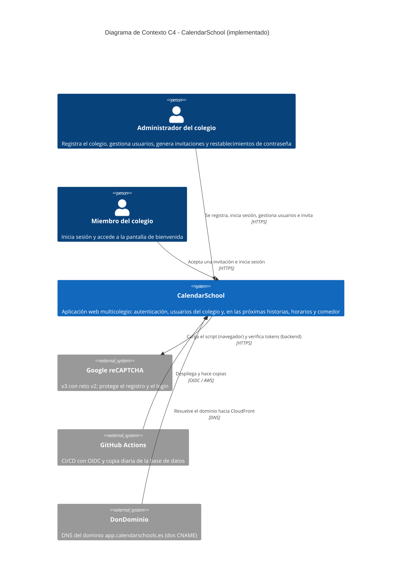

El sistema solo distingue `ADMIN` y `MEMBER`. Los cargos del profesorado (director, jefe de estudios) son un dato informativo del profesor y no un actor ni un permiso.

---

## Nivel 2: Contenedores

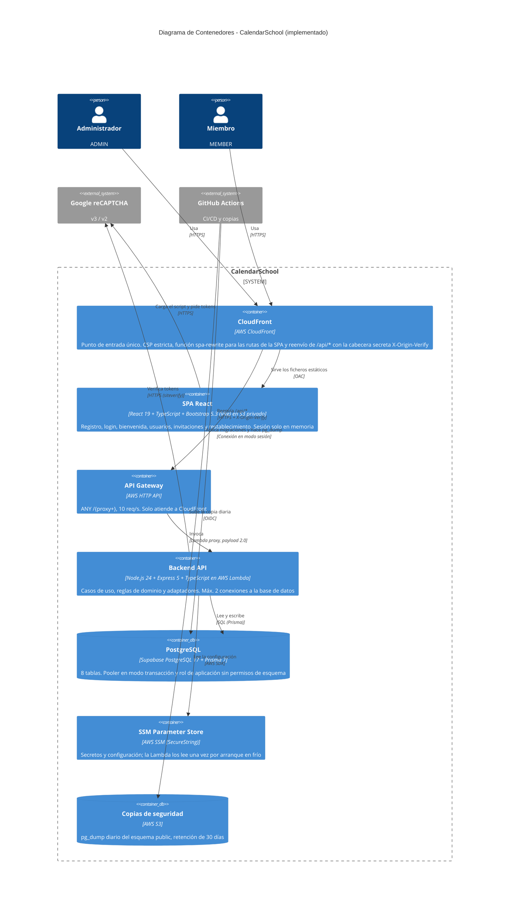

---

## Nivel 3: Componentes del backend

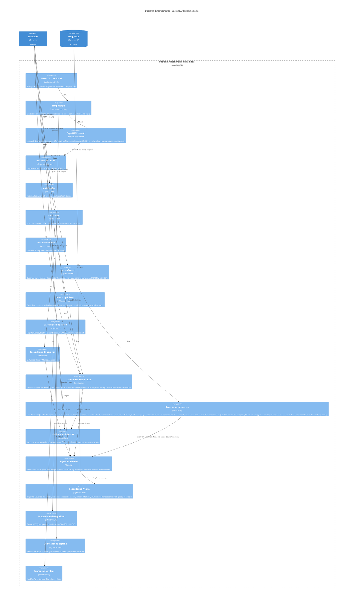

---

## Nivel 3: Componentes del frontend

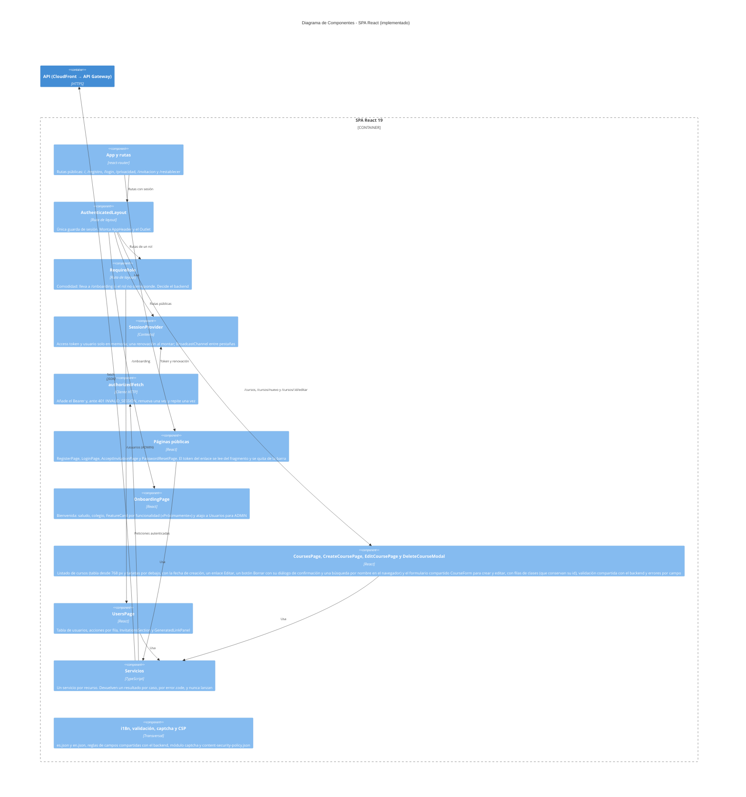

---

## Nivel 3: Base de datos

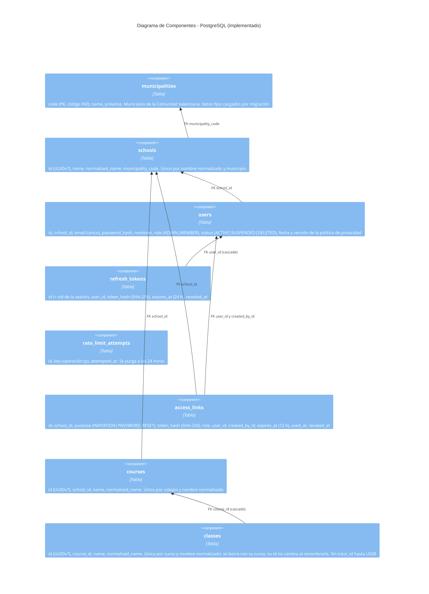

Particularidades que Prisma no modela y están escritas a mano en las migraciones: el `CHECK` de `users` (fecha y versión de la política, las dos o ninguna), el `CHECK` de `access_links` (`role` solo en invitaciones, `user_id` solo en restablecimientos) y el índice único parcial `access_links_pending_reset_user_key` (un restablecimiento pendiente por usuario).

---

## Flujos principales

**Petición protegida (identidad y autorización):**

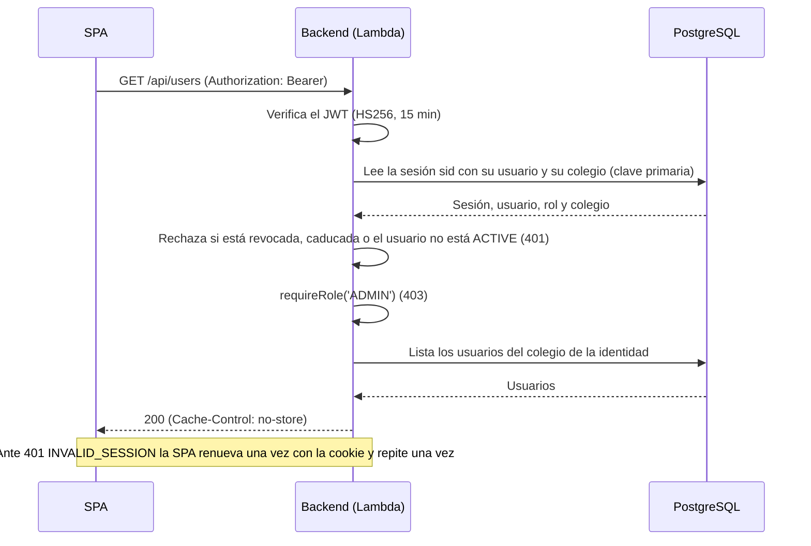

**Invitación de una persona al colegio:**

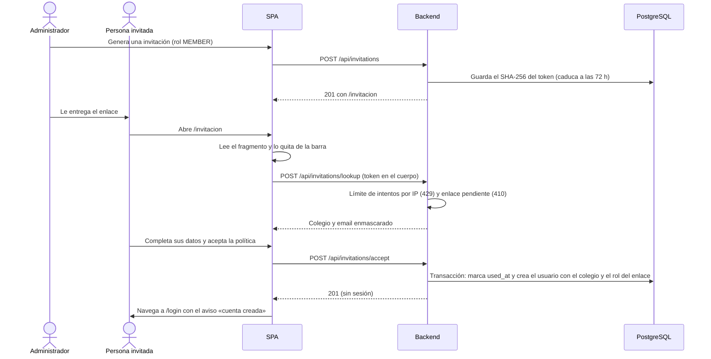

El restablecimiento de contraseña sigue el mismo patrón con `/restablecer#token`; al confirmar, la transacción cambia la contraseña y revoca todas las sesiones abiertas del usuario.

**Crear un curso con sus clases:**

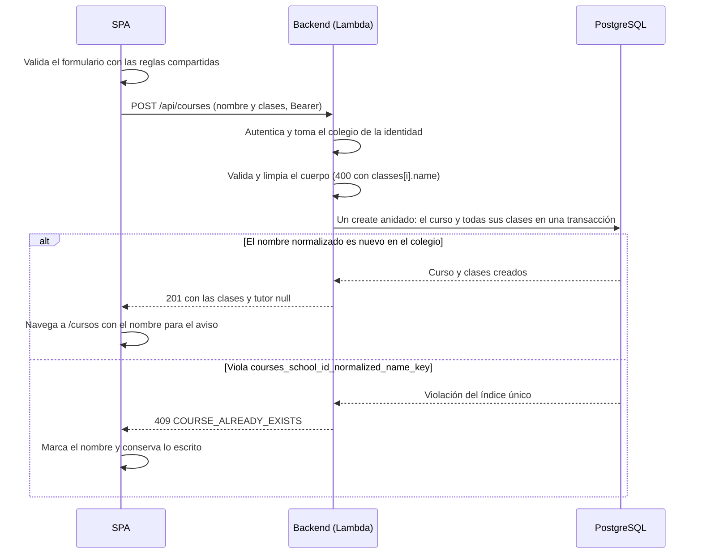

**Editar un curso:**

```mermaid
sequenceDiagram
    participant S as SPA
    participant B as Backend (Lambda)
    participant D as PostgreSQL

    S->>B: GET /api/courses/{id} (Bearer)
    B-->>S: 200 con las clases y su id (404 si es de otro colegio o no existe)
    S->>S: Rellena el formulario; Guardar solo con cambios reales
    S->>B: PUT /api/courses/{id} (nombre y clases con id si ya existían)
    B->>B: Autentica, toma el colegio de la identidad y valida el cuerpo
    B->>D: Transacción: bloquea la fila del curso (FOR UPDATE) y lee sus clases
    B->>B: planCourseUpdate (qué se borra, se renombra y se crea)
    alt Pide una clase que el curso ya no tiene
        B-->>S: 409 COURSE_CHANGED (no se guarda nada)
        S->>S: Avisa y ofrece Recargar
    else El nombre lo tiene otro curso del colegio
        D-->>B: Violación del índice único del curso
        B-->>S: 409 COURSE_ALREADY_EXISTS (se deshace todo)
        S->>S: Marca el nombre y conserva lo escrito
    else Se guarda
        B->>D: Curso, borrar, renombrar en dos fases y crear
        B-->>S: 200 con el curso final
        S->>S: Navega a /cursos con el aviso
    end
```

**Borrar un curso:**

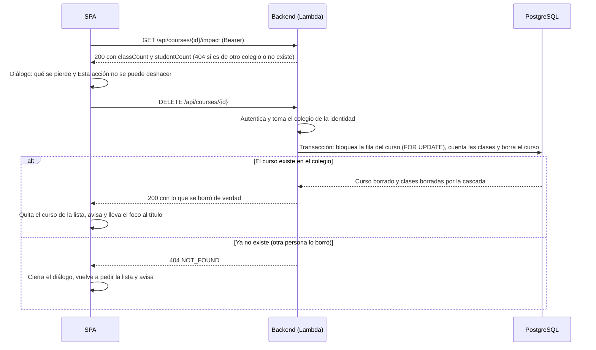

---

# Parte B: arquitectura objetivo 🎯

> Los diagramas siguientes son el diseño de la generación de horarios y de la infraestructura ampliada. **No están construidos**: no existen la cola, la caché, el solver ni la mayoría de las tablas. Se irán incorporando con las historias de calendarios, restricciones y horarios. Lo que sí existe (`users`, `refresh_tokens`) tiene hoy otro esquema (ver el Nivel 3 de la base de datos de la parte A).

## Nivel 1 (objetivo): Contexto del sistema

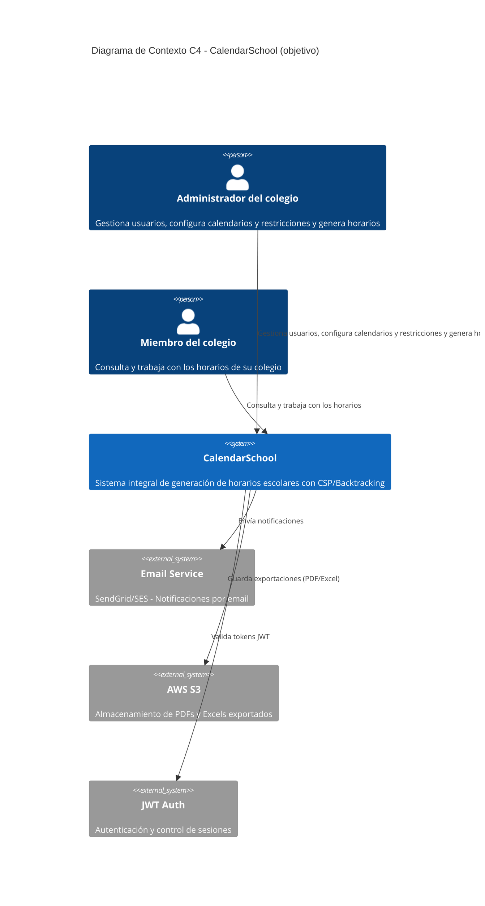

---

## Nivel 2 (objetivo): Contenedores

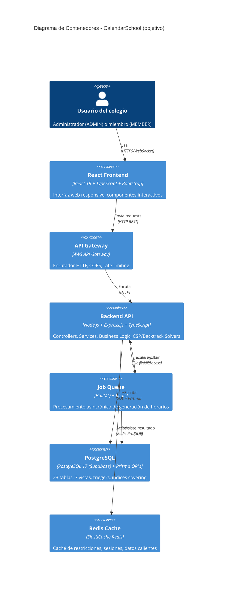

---

## Nivel 3 (objetivo): Componentes del backend

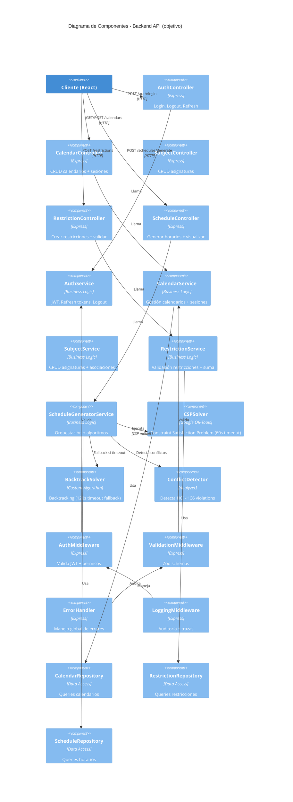

---

## Nivel 3 (objetivo): Base de datos

```mermaid
C4Component
    title Diagrama de Componentes - PostgreSQL (objetivo)

    Component(users_table, "users", "Tabla", "id, email, password, role, status")
    Component(roles_table, "roles", "Tabla", "id, name, permissions JSON")
    Component(refresh_tokens_table, "refresh_tokens", "Tabla", "id, userId, tokenHash, isRevoked, expiresAt")

    Component(calendars_table, "calendars", "Tabla", "id, name, startDate, endDate, status")
    Component(sessions_table, "sessions", "Tabla", "id, calendarId, sessionNumber, startTime, endTime, isBreak")

    Component(subjects_table, "subjects", "Tabla", "id, name, type (CORE/ELECTIVE), status")
    Component(subject_courses_table, "subject_courses", "M:M", "subjectId, courseId")

    Component(restrictions_table, "restrictions", "Tabla", "id, type, subjectId, courseId, params JSON, status")
    Component(restriction_audit_table, "restriction_audit_trail", "Tabla", "id, restrictionId, changedAt, changedBy, beforeValue, afterValue")

    Component(schedules_table, "schedules", "Tabla", "id, calendarId, status, algorithm, generatedBy, solvedAt")
    Component(schedule_entries_table, "schedule_entries", "Tabla", "id, scheduleId, courseId, dayOfWeek, sessionNumber, subjectId, professorId, roomId")
    Component(generation_jobs_table, "schedule_generation_jobs", "Tabla", "id, calendarId, status, progress, result JSON")

    Component(view_professor_overlap, "schedule_conflicts_professor_overlap", "Vista", "HC2: Detecta profesor en 2 aulas simultaneas")
    Component(view_availability, "schedule_conflicts_availability", "Vista", "HC3: Fuera de disponibilidad")
    Component(view_professor_load, "professor_load_summary", "Vista", "Carga horaria por profesor")

    Component(idx_single_location, "IX_professor_session", "Índice Covering", "profesorId, dayOfWeek, sessionNumber + subjectId, roomId")
    Component(idx_calendar_status, "IX_calendar_status", "Índice", "calendarId, status, createdAt DESC")
    Component(idx_restriction_course, "IX_restriction_course", "Índice", "courseId, status + type, params")

    Rel(users_table, roles_table, "FK role", "")
    Rel(refresh_tokens_table, users_table, "FK userId", "")

    Rel(sessions_table, calendars_table, "FK calendarId", "")
    Rel(subject_courses_table, subjects_table, "FK subjectId", "")

    Rel(restrictions_table, subjects_table, "FK subjectId", "")
    Rel(restriction_audit_table, restrictions_table, "FK restrictionId", "")

    Rel(schedule_entries_table, schedules_table, "FK scheduleId", "")
    Rel(generation_jobs_table, calendars_table, "FK calendarId", "")

    Rel(view_professor_overlap, schedule_entries_table, "SELECT FROM", "")
    Rel(view_availability, schedule_entries_table, "SELECT FROM", "")
    Rel(view_professor_load, schedule_entries_table, "SELECT FROM AGGREGATE", "")

    Rel(idx_single_location, schedule_entries_table, "Indexa", "")
    Rel(idx_calendar_status, schedules_table, "Indexa", "")
    Rel(idx_restriction_course, restrictions_table, "Indexa", "")
```

---

## Nivel 3 (objetivo): Flujo del algoritmo CSP

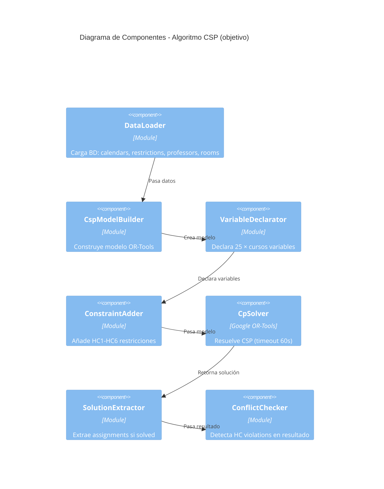

---


## Leyenda

| Símbolo | Significado |
|---------|------------|
| ✅ / Parte A | Implementado y desplegado |
| 🎯 / Parte B | Arquitectura objetivo, aún no construida |
| **Contenedor (C4)** | Sistema independiente (frontend, backend, BD) |
| **Componente** | Unidad de código dentro de un contenedor |
| **FK** | Foreign Key (relación de BD) |
| **Índice Covering** | Índice que incluye todas las columnas (sin acceso a tabla) |
| **Vista** | Consulta guardada en BD para reportes |

---

## Notas Arquitectónicas

### Decisiones clave de lo implementado

1. **Monolito modular en capas con puertos y adaptadores.** Presentación → aplicación → dominio, con la infraestructura implementando los puertos. Una única raíz de composición (`composeApp`) y dos puntos de entrada sin lógica.
2. **Mismo origen para la SPA y la API.** CloudFront sirve ambos; no hay CORS y la cookie de sesión `HttpOnly` funciona.
3. **Sesión revocable al instante.** El access token (15 min) lleva el id de su sesión y cada petición protegida lo comprueba por clave primaria; el rol y el colegio salen de la base de datos.
4. **Enlaces de un solo uso.** Invitaciones y restablecimientos viajan en el fragmento de la URL, se muestran una vez y solo se guarda su SHA-256.
5. **Aislamiento por colegio.** Todo puerto que accede a datos de un colegio recibe `schoolId` de la identidad, nunca del cliente.
6. **Contrato primero.** `docs/api-spec.yml` es la fuente de los tipos del frontend; CI falla si no están al día.

### Del objetivo, lo que se mantiene como línea de diseño

1. **Algoritmo CSP + Backtracking:** CSP (Google OR-Tools) como camino principal y Backtracking determinista como alternativa.
2. **Job Queue (BullMQ + Redis):** generación asíncrona, con reintentos y persistencia.
3. **Índices covering** para detectar HC2 (`profesorId, dayOfWeek, sessionNumber`) y buscar calendarios.
4. **Borrado lógico y auditoría** de profesores, asignaturas y calendarios.

### Flujos del objetivo

**Crear calendario** → POST /calendars → CalendarService → INSERT calendars + sessions (trigger) → audit_logs

**Generar horario** → POST /schedules/generate → BullMQ.enqueue → worker → CSP Solver (60 s) → persistir y detectar conflictos → UPDATE schedules

**Buscar restricciones** → GET /restrictions → RestrictionRepository → caché Redis → <100 ms

---
